# SUDO QUEST — 인프라 장애 대응 퀘스트

> *A browser game where you fix deliberately broken virtual servers from a fake terminal — with a RAG coach that cites official docs and never gives away the answer.*

브라우저 안의 **가상 터미널**에서 명령어를 입력해, 일부러 망가뜨린 **가상 서버**의 장애 원인을 찾고 복구하는 학습 게임입니다.
막히면 **AI 코치**가 내가 실행한 명령의 출력과 **공식 문서만** 근거로 다음에 볼 곳을 함께 생각해 줍니다. 정답은 알려 주지 않습니다.


<sub>실습 1 "웹사이트가 갑자기 안 열려요" — 상태·로그·디스크 조사 → 원인 제출(한 번 틀림) → 복구 → 리포트. 실제 앱 화면을 자동으로 조작해 만든 GIF입니다(`tools/demo`).</sub>

- **설치 없이 브라우저에서**: 게임은 서버·DB·API 키 없이 동작합니다(정적 사이트). 배포 링크는 배포 후 여기에 붙입니다.
- **실제 시스템을 건드리지 않습니다**: 모든 명령은 메모리 안의 가상 상태만 바꿉니다. 실제 명령을 실행하는 코드가 없습니다.
- **실무 감각 그대로**: 명령 출력은 실제 Linux·AWS CLI·kubectl·docker 형식을 따르고, **언제나 지금 상태에서 계산**합니다. 로그를 지우면 `df -h`가 저절로 줄어듭니다.

---

## 무엇을 배우나

정답 맞히기가 아니라 **사고 과정**을 훈련합니다. 모든 실습이 같은 흐름을 따릅니다.

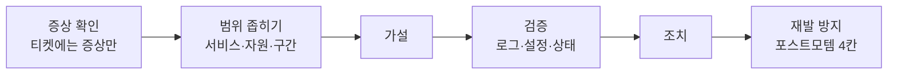

- **실습 24개 + 5분 튜토리얼**: Linux 5 · 네트워크 3 · 웹/DB 5 · AWS 3 · Docker 3 · Kubernetes 5. 가상 명령 39개.
- **3단계 힌트**(방향 질문 → 볼 곳 → 거의 정답)와 힌트 아래 **용어 풀이**(포트·DNS·EAI_AGAIN…).
- **학습 점수**: 도움을 받은 만큼(힌트 80·100·120점)과 잘못 단정한 만큼(오답 80점)만 깎습니다. 시간·명령 수는 기록만 합니다.
- **지원하지 않는 명령**은 실제 셸처럼 `bash: netstat: command not found`로 답하고, 대신 쓸 명령(`ss -tlnp`)은 터미널 아래 안내에서 알려 줍니다.

| # | 분야 | 난이도 | 티켓(증상) |
|---:|---|---|---|
| 1 | Linux | 입문 | 웹사이트가 갑자기 안 열려요 |
| 2 | Linux | 입문 | 사이트에 들어가면 403 Forbidden이 떠요 |
| 3 | Linux | 중급 | nginx를 재시작했더니 아예 안 올라와요 |
| 4 | Linux | 중급 | API 서버가 자꾸 죽어요 |
| 5 | 네트워크 | 입문 | 밖에서는 사이트가 안 열린다는데, 서버는 멀쩡해요 |
| 6 | 네트워크 | 입문 | 결제 API 호출이 전부 실패해요 |
| 7 | 네트워크 | 중급 | 서버 안에서는 되는데 다른 서버에서는 안 돼요 |
| 8 | 웹/DB | 입문 | 설정 조금 바꿨을 뿐인데 사이트가 통째로 내려갔어요 |
| 9 | 웹/DB | 중급 | 고객들이 '안전하지 않은 사이트'라는 경고를 본대요 |
| 10 | 웹/DB | 고급 | 트래픽 몰리는 시간대에만 500 에러가 나요 |
| 11 | AWS | 입문 | 새로 만든 EC2에 SSH가 안 붙어요 |
| 12 | AWS | 중급 | 헬스 알람이 울리는데 사이트는 열려요 |
| 13 | AWS | 중급 | 상품 이미지 업로드가 전부 실패해요 |
| 14 | Kubernetes | 중급 | 배포 후 쇼핑몰이 돌아오지 않아요 |
| 15 | Kubernetes | 중급 | 배포 직후 주문하기가 전부 실패해요 |
| 16 | Kubernetes | 고급 | 오후 작업 뒤 상품 목록이 텅 비었어요 |
| 17 | Docker | 중급 | 배포 완료라는데 옛 버전이 그대로예요 |
| 18 | Docker | 중급 | 가입 인증 메일이 오지 않아요 |
| 19 | Kubernetes | 중급 | 배포 뒤 검색만 계속 실패해요 |
| 20 | Kubernetes | 중급 | 결제 서버에 연결할 수 없대요 |
| 21 | Docker | 중급 | 오늘 배포 빌드가 계속 실패해요 |
| 22 | Linux | 고급 | 타임 세일이 시작되자 API가 응답을 멈췄어요 |
| 23 | 웹/DB | 중급 | 배포 뒤 상품 목록이 Bad Gateway래요 |
| 24 | 웹/DB | 고급 | 일부 고객만 '안전하지 않은 연결'이래요 |

<details>
<summary>⚠️ 스포일러: 실습별 핵심 학습</summary>

| # | 핵심 학습 |
|---:|---|
| 1 | 원인을 없애도 서비스는 스스로 살아나지 않는다 |
| 2 | 403은 서버가 살아 있다는 뜻이다 |
| 3 | 원인과 증상 사이에 시간차가 있을 수 있다 |
| 4 | 죽은 프로세스가 범인이 아닐 수 있다 |
| 5 | 서버 안 헬스체크는 이 장애를 못 잡는다 |
| 6 | 이름 해석 실패와 연결 실패는 다르다 |
| 7 | 바인딩 주소가 접근 범위를 결정한다 |
| 8 | restart와 reload의 차이 |
| 9 | 자동화를 믿지 말고 자동화를 감시하라 |
| 10 | 스케일 아웃은 공짜가 아니다 |
| 11 | timeout과 refused의 차이 |
| 12 | 모든 타깃이 unhealthy면 ALB는 fail-open한다(AWS 문서 기준) |
| 13 | AccessDenied 메시지를 끝까지 읽어라 |
| 14 | 이미지 설정 성공과 파드 Ready·엔드포인트 복구를 구분한다 |
| 15 | CrashLoopBackOff는 '시작은 했다'는 뜻, 직전 실행 로그를 읽어라 |
| 16 | OOMKilled(137)는 앱 로그에 남지 않는다, request가 아니라 limit이다 |
| 17 | "배포 완료"가 아니라 실제 응답 버전을 확인하라, Created는 한 번도 실행되지 않았다는 뜻이다 |
| 18 | 컨테이너 환경 변수는 바꿀 수 없다, -e KEY는 셸 값을 넘긴다 |
| 19 | Running과 Ready는 다르다, Ready가 아니면 엔드포인트에서 빠진다 |
| 20 | Service는 라벨로 파드를 고른다, 엔드포인트 &lt;none&gt;은 셀렉터부터 본다 |
| 21 | 어느 디스크가 찼는지부터, /var/lib/docker는 rm이 아니라 prune으로 |
| 22 | 셸의 ulimit와 서비스 한도는 다르다, unit을 고치면 daemon-reload |
| 23 | 502는 nginx가 답한 것, 뒤쪽(upstream) 주소와 앱 포트를 비교하라 |
| 24 | 브라우저가 된다고 체인이 온전한 건 아니다, 중간 인증서를 함께 보내라 |

</details>

---

## 화면 둘러보기

| 캠퍼스(홈) | 브리핑 |
|---|---|
| 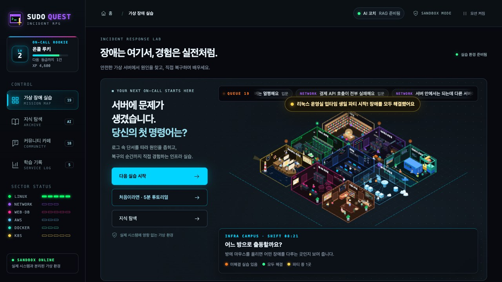 | 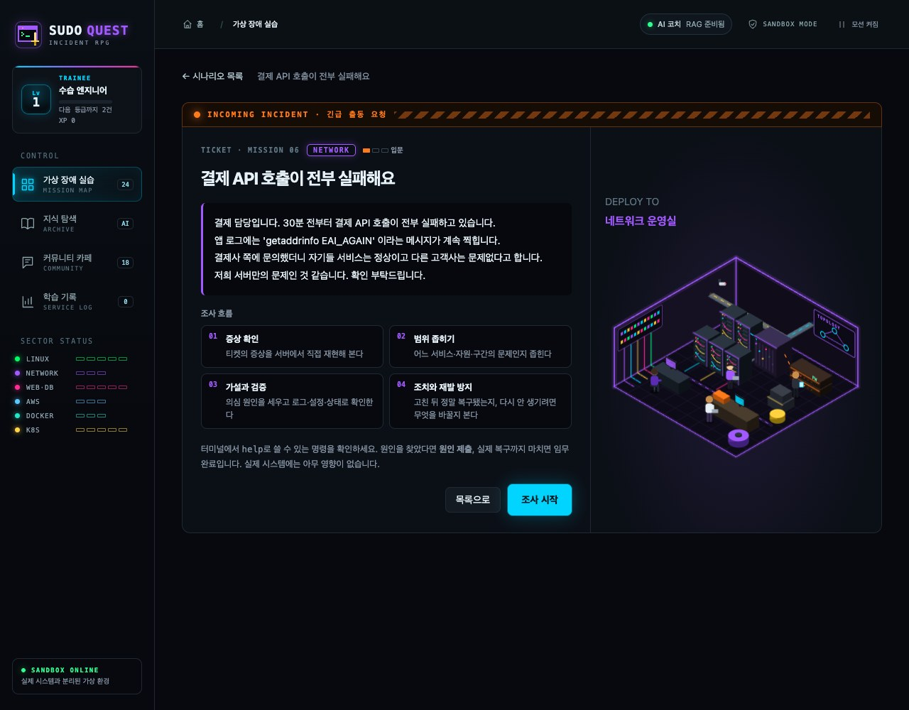 |
| 미해결 실습이 있는 방에 경보등, 한 분야를 다 풀면 그 방이 파티 | 티켓에는 **증상만**. 원인은 서버에서 찾는다 |
| **실습 + 힌트 용어 풀이** | **리포트** |
| 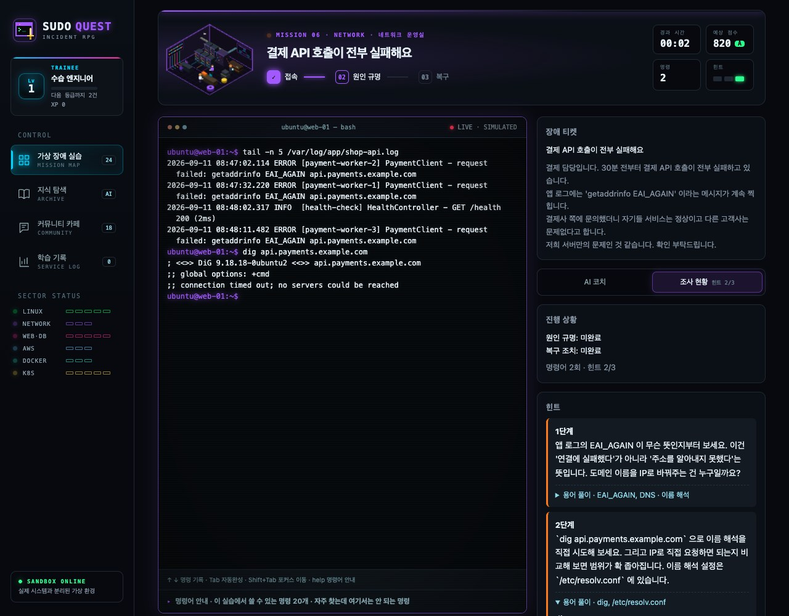 | 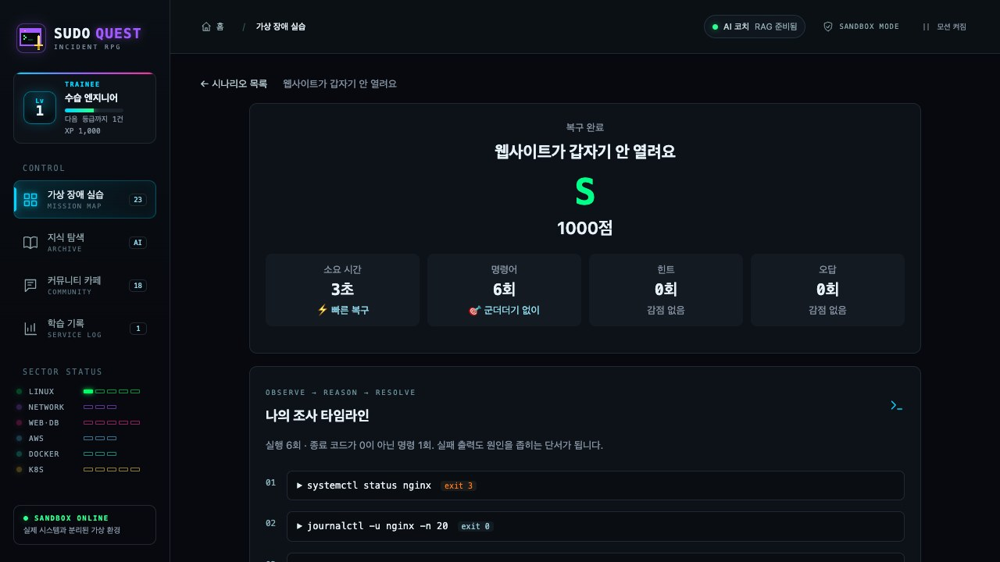 |
| 출력은 상태에서 계산, 힌트 아래 **용어 풀이** | 학습 점수, 조사 타임라인, 포스트모템, 모범 풀이 비교 |
| **지식 탐색(RAG)** | **커뮤니티 카페** |
| 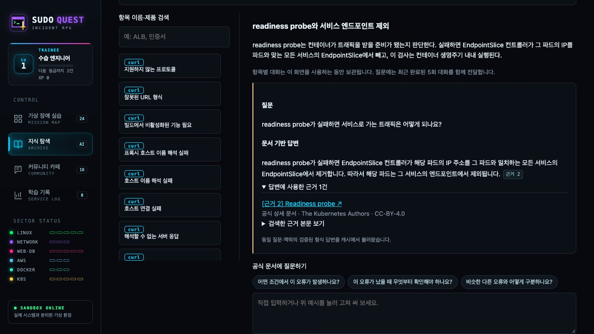 | 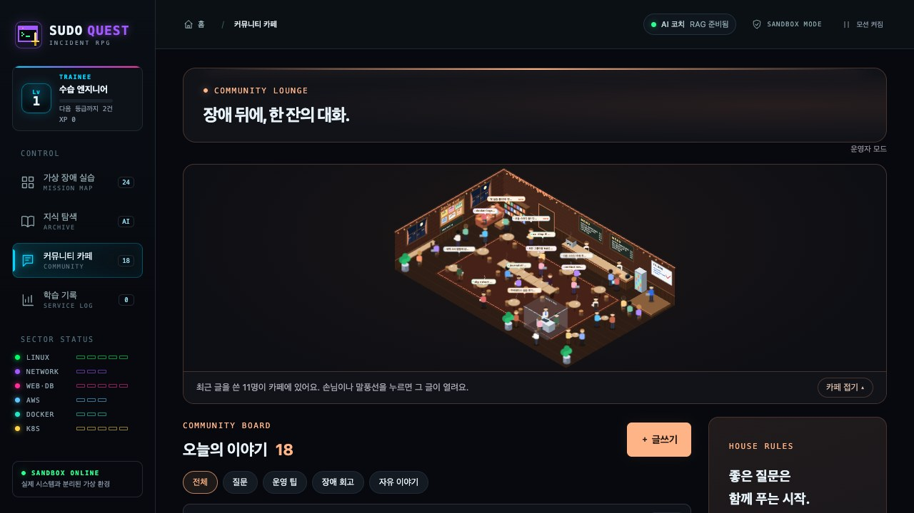 |
| 모든 주장에 `[근거 N]`과 원문 링크 | 질문·운영 팁·장애 회고 게시판(FastAPI + SQLite) |
| **피날레** | **엔딩 크레딧** |
| 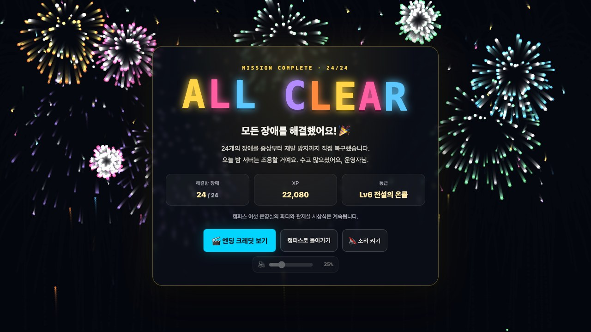 | 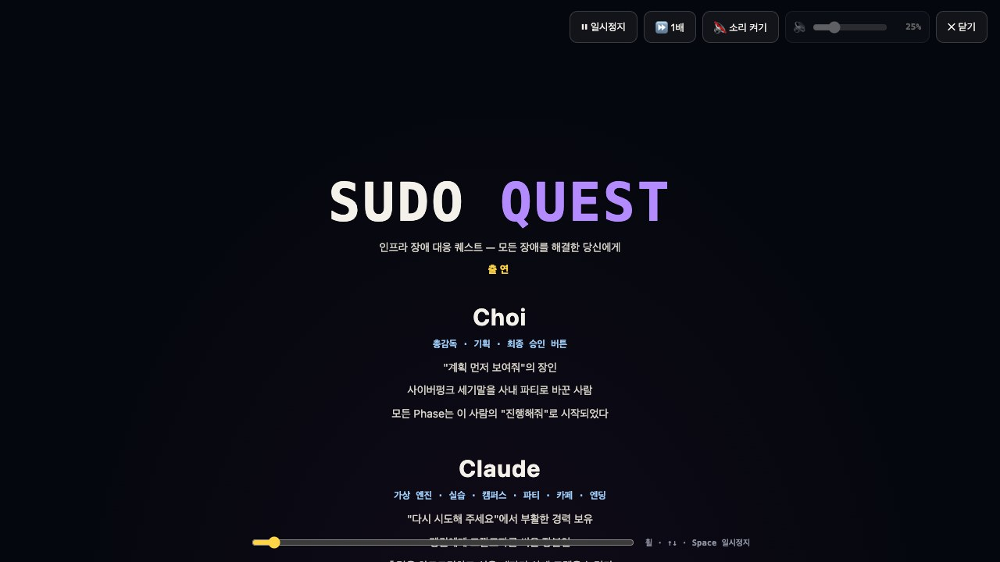 |
| 24개를 모두 풀면 불꽃놀이 | 8비트 캉캉(퍼블릭 도메인 곡을 Web Audio로 연주) |

| 5분 튜토리얼 | AI 코치 |
|---|---|
|  |  |
| 명령을 실제로 쳐야 다음 말풍선으로. 기록·점수에는 안 남는 연습 실습 | `[실습 기록 N]`·`[근거 N]` 인용, 정답 정보는 서버로 보내지 않음 |

---

## 어떻게 만들었나

### 가상 엔진 — 출력은 언제나 "지금 상태"에서 계산

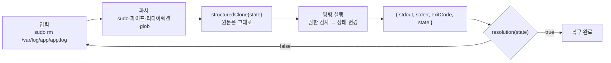

- 시나리오는 **초기 상태 + 장애 주입**만 정의하는 데이터입니다. `df -h`는 파일 크기 합으로, `ss -tlnp`는 프로세스가 연 소켓으로, `curl`은 이름 해석 → 방화벽 → 리스닝 → TLS → 권한 체인으로 계산합니다.
- 새 시나리오는 **파일 하나**를 추가하면 됩니다([시나리오 추가 가이드](docs/SCENARIO_GUIDE.md)). 엔진을 고쳐야 한다면 엔진이 충분히 일반적이지 않다는 신호로 보고 엔진을 일반화합니다.
- 의존 방향은 `ui → scenarios → engine` 한 방향, `engine`은 React를 모릅니다. 런타임 의존성은 `react`·`react-dom` **두 개뿐**입니다.
- 자세한 구조와 원칙: [docs/ENGINE_DESIGN.md](docs/ENGINE_DESIGN.md)

### RAG 코치 — 공식 문서만 근거로, 정답은 모른 채

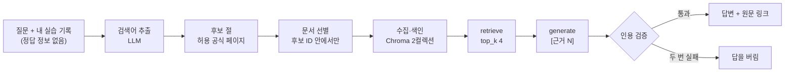

- 학습 항목 131개(curl·Linux errno·AWS ALB·AWS·Kubernetes·Docker), 공식 문서 절 220개. FastAPI · Chroma · LangGraph(retrieve → generate).
- 무거운 요청은 `202 + 작업 폴링`, 진행 단계를 화면에 보여 줍니다. 공급자 5xx·시간 초과는 1회만 재시도합니다.
- 코치 요청에는 티켓·연 힌트·내가 친 명령과 출력만 들어가고, 서버는 정답 필드가 오면 422로 거부합니다.

### 테스트

| 묶음 | 수 | 무엇을 |
|---|---:|---|
| 프론트(Vitest) | 957 | **모든 시나리오 자동 풀이**(주입 직후 미복구 → 모범 풀이로 복구, 실패 신호 없음), 정답 밖 탐색(조회 반복·역순·무관한 조치·대체 풀이), 명령 출력, 파서, 퍼징 |
| 백엔드(unittest) | 87 | 인용 검증, 정답 정보 차단, 캐시·색인 정체성, **고장 주입**(5xx 재시도·인용 실패·근거 부족 보류·robots·429), 게시판 |

풀 수 없는 시나리오가 들어오면 CI가 실패합니다. 매번 같은 순서로 검사하는 목록: [정기 검증 체크리스트](docs/infra-coach/23_정기_검증_체크리스트.md)

---

## 설계 결정과 근거

| 결정 | 왜 |
|---|---|
| [202 + 작업 폴링](docs/infra-coach/adr/001-async-jobs.md) | 질문 하나에 LLM 2~4회, 진행 단계를 보여 주고 시간 제한을 피한다 |
| [Chroma 컬렉션 2개](docs/infra-coach/adr/002-two-collections.md) | 항목 고르기(요약)와 근거 찾기(원문 청크)를 분리한다 |
| [게시판은 SQLite 한 파일](docs/infra-coach/adr/003-sqlite-community.md) | 스터디 규모, 의존성 0 |
| [인용 검증 · 후보 ID 안에서만 선별](docs/infra-coach/adr/004-citation-validation.md) | 근거 없는 말과 지어낸 URL을 막는다 |
| [코치에는 플레이어가 본 것만](docs/infra-coach/adr/005-coach-answer-isolation.md) | 정답을 알면 흘린다 — 게임의 목적이 무너진다 |
| [답변 캐시 키 · 색인 manifest](docs/infra-coach/adr/006-cache-and-manifest.md) | 바뀐 것만 다시, 설정이 어긋난 색인은 막는다 |
| [공급자 일시 장애만 1회 재시도](docs/infra-coach/adr/007-provider-retry.md) | 502 한 번은 사용자에게 보이지 않게, 4xx는 바로 |

**평가 v2** (질문 24개, 정답 절·핵심 사실을 실행 전에 고정, 2026-10-23, 생성 모델 `gpt-6-luna` — 제출 모델 `gpt-6.1-sol`과 다름) · [전체 결과·방법·한계](docs/infra-coach/22_RAG_근거_보강.md)

| 검색만(18문항) | 답변까지(24문항) | 지연(캐시 미적중) |
|---|---|---|
| Hit@4 **18/18** · MRR **0.944**<br/>항목 자동 선택 Hit@3 **18/18** | 성공 **23/24**(인용 검증 실패 1) · 오답 **0**<br/>정답 절 인용 **17/17** · 문서 밖 질문 보류 **3/3** | p50 **11.8초** · p95 **15.1초**<br/>캐시 적중 2ms 이하 |

표본이 작고 채점은 개발 도우미가 했습니다(사람 검토 표본 지정). RAG 사용 전후 비교는 [08번](docs/infra-coach/08_RAG_전후비교.md), 청크·Top-k 비교는 [09번](docs/infra-coach/09_청크_TopK_비교.md).

---

## 실행하기

```bash
npm ci
npm run dev        # 게임만: http://127.0.0.1:5173 (서버·키 필요 없음)
```

AI 코치·지식 탐색·게시판까지 쓰려면 Python 백엔드와 키(`backend/.env`의 `GMS_KEY`, 이 파일에만)가 필요합니다 → **[docs/RUNNING.md](docs/RUNNING.md)**
데이터 출처·라이선스·알려진 한계 → **[docs/DATA_SOURCES.md](docs/DATA_SOURCES.md)**

## 기여하기

시나리오 추가는 `src/scenarios/`에 **파일 하나**를 만드는 일입니다. 자동 검증 테스트가 풀 수 있는지 확인해 줍니다 → [docs/SCENARIO_GUIDE.md](docs/SCENARIO_GUIDE.md)

## 한계와 다음 계획

- 정답 데이터가 브라우저 코드에 있어 순위 경쟁에는 아직 쓸 수 없습니다 → 로그인·서버 검증 뒤 **챌린지 모드**.
- **Google 로그인·첫 로그인 튜토리얼·배포**(Pages + API 서버) 계획: [19번 문서](docs/infra-coach/19_로그인_튜토리얼_배포_계획.md)
- RAG 개선 후보: 긴 원문 절의 인용 실패, 오류 코드 뜻을 빼먹는 답, 보류 자동 판정(평가 v2에서 발견).
- 초보 사용자 관찰: [관찰 양식](docs/infra-coach/21_초보_관찰_양식.md)
- 더 먼 과제: 모니터링 대시보드 단서, 여러 장애가 겹치는 복합 시나리오. 엔진은 장애 주입을 배열로, 상태에 시뮬레이션 시각(clock)을 두어 이를 열어 두었습니다.

## 만든 사람

- **Choi** — 총감독·기획, 모든 Phase의 "계획 먼저 보여줘"
- **Claude** — 가상 엔진·실습·캠퍼스·카페·엔딩·RAG 근거 보강
- **GPT (Codex)** — 쿠버네티스 첫 실습, 정답 밖 탐색 점검, 퀘스트 연출

누가 무엇을 했는지와 사라진 기능의 무덤은 게임의 엔딩 크레딧에 있습니다.

---

### 과제 제출 문서 (AI 코어 프로젝트 2회차)

[요구사항 정의서](docs/submission/요구사항정의서.md) · [RAG 파이프라인 설계문서](docs/submission/RAG_파이프라인_설계문서.md) · [검증 결과](docs/submission/검증결과.md) · [RAG 전후 비교](docs/submission/RAG_전후비교.md) · [청크·Top-k 비교](docs/submission/청크_TopK_비교.md) · [출처 고지](THIRD_PARTY_NOTICES.md) · [작업 기록](docs/infra-coach/HANDOFF.md)

| 구분 | 기능 |
|---|---|
| 필수 F2001~F2012 | 항목 색인, 검색어 추출·후보 선별·문서 수집, 두 컬렉션 검색·병합, retrieve→generate 그래프, 인용 표시, 항목별 대화, 게임 코치(특화), 조건 탐색, 진행 상태·오류 안내 |
| 심화 F2013 | React/TypeScript 화면 직접 구현(FastAPI와 분리, 요청·응답 계약) |
| 심화 F2015 | RAG 사용 전후 답변 비교(9문항) + 평가 v2(24문항) |
