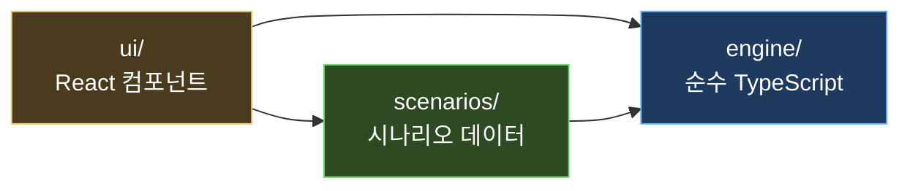
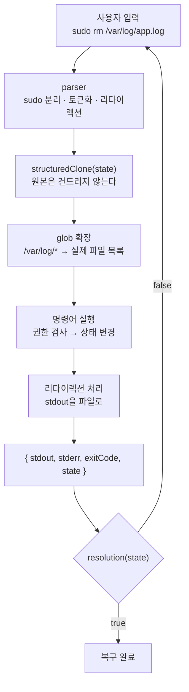

# InfraCoach — 인프라 장애 대응 학습

가상 장애 대응 게임에 **공식 문서 근거 RAG 코치**를 붙인 인프라 학습 서비스입니다(AI 코어 프로젝트 2회차).

- **지식 탐색·질의응답**: curl·Linux errno·AWS·Kubernetes·Docker 공식 문서 131개 항목(실습 시나리오를 뒷받침하는 쿠버네티스·도커·AWS·Linux 문서 31개 포함)을 공식 문서 근거로 설명합니다. 모든 주장에 [근거 N]과 원문 링크가 붙고, 문서에 없으면 답을 보류합니다.
- **조건으로 항목 찾기**: "curl에서 인증서 검증과 관련된 오류"처럼 자연어로 조건을 적으면 맞는 항목만 보여줍니다.
- **실습 코치**: 실습 중 막히면 내가 실행한 명령의 출력과 공식 문서만으로 다음 점검을 안내합니다. 정답·풀이는 코치에게 전달되지 않고, 복구 판정은 게임 엔진이 합니다.
- **커뮤니티 카페(게시판)**: 질문·운영 팁·장애 회고를 나누는 게시판(FastAPI + SQLite). 익명 닉네임과 선택 삭제 비밀번호, 운영자 삭제, 코드 블록 표시, 실습 리포트에서 바로 회고 작성(풀이가 담긴 글은 미리보기를 가림). 목록 위에는 큰 사내 카페(커피 바·장테이블·회의 부스·TIL 무대)가 있어, 최근 글쓴이가 손님이 되어 돌아다니고 머리 위 말풍선에 글 제목이 뜹니다(누르면 그 글이 열림). 말풍선 없는 배경 직원들이 카페를 북적이게 하고, `scripts.seed_community`로 예시 글을 넣을 수 있습니다. 백엔드가 꺼져 있어도 게임은 동작합니다. 자세한 동작은 [backend/README](backend/README.md#커뮤니티-게시판-sqlite).

| 구분 | 기능 |
|---|---|
| 필수 F2001~F2012 | 항목 100건 색인, 검색어 추출·후보 선별·문서 수집, 두 컬렉션 검색·병합, retrieve→generate 그래프, 인용 표시, 항목별 대화, 게임 코치(특화), 조건 탐색, 진행 상태·오류 안내 |
| 심화 F2013 | React/TypeScript 화면 직접 구현(FastAPI와 분리, 요청·응답 계약) |
| 심화 F2015 | RAG 사용 전후 답변 비교(9문항) |

제출 문서: [요구사항 정의서](docs/submission/요구사항정의서.md) · [RAG 파이프라인 설계문서](docs/submission/RAG_파이프라인_설계문서.md) · [검증 결과](docs/submission/검증결과.md) · [RAG 전후 비교](docs/submission/RAG_전후비교.md) · [청크·Top-k 비교](docs/submission/청크_TopK_비교.md) · [출처 고지](THIRD_PARTY_NOTICES.md)


## 게임 화면 미리보기 (2026-10-21)

화면에 표시되는 앱 이름은 **SUDO QUEST(수도퀘스트)** 입니다. 홈은 아이소메트릭 캠퍼스(분류별 운영실 4개 — 리눅스·네트워크·웹·DB·클라우드 — + 관제실·자료실, 컨테이너·쿠버네티스 운영실, 카페 분위기의 커뮤니티실)이고, 미해결 실습이 있는 방에 경보등이 켜지고, 한 분류를 모두 해결하면 그 운영실이 방마다 다른 사내 파티(업타임 생일 파티·핑퐁 대회·쿼리 칵테일 바·루프톱 풍선 파티·고래 풀 파티·선상 보물 연회)로 바뀝니다. 전부 해결하면 관제실에서 시상식이 열리고, 불꽃놀이와 축하 메시지가 담긴 피날레와 엔딩 크레딧(8비트 캉캉, 퍼블릭 도메인 곡을 Web Audio로 직접 연주·음소거 가능)이 이어집니다. 준비 중인 실습은 목록에 `OPENING SOON` 카드로 미리 보입니다. 운영자 등급(해결 수 기반), 출동 대기 티켓 전광판, 미션 HUD(경과 시간·예상 점수·퀘스트 단계), 실습 중 AI 코치(빠른 질문·제안 명령을 터미널에 입력)를 제공합니다. 경보등·숫자는 모두 실제 학습 기록이며 서버 모니터링 값이 아닙니다. 모션 일시정지와 OS의 모션 줄이기 설정을 지원합니다. 게임은 API 키 없이 실행됩니다. 클리어 리포트에는 시나리오가 실제로 일어나는 장애라는 근거(공식 문서·공개 포스트모템)가 "참고 자료"로 붙습니다. 새 시나리오·분류 추가는 [시나리오 추가 가이드](docs/SCENARIO_GUIDE.md)를 보세요.

```bash
npm ci
npm run setup:env   # .env와 backend/.env 생성. 기존 파일은 덮어쓰지 않음
npm run dev
```

브라우저에서 `http://127.0.0.1:5173/`을 엽니다. **키는 `backend/.env`의 `GMS_KEY=`에만 입력**합니다. 루트 `.env`는 `BACKEND_PROXY_TARGET`(기본 `http://127.0.0.1:8000`)만 설정합니다. 두 파일은 Git에서 제외됩니다. 키를 넣은 뒤에는 Python 서버를 다시 시작해야 합니다. RAG에는 별도로 Python 의존성 설치와 지식 색인 준비가 필요합니다.

macOS/Linux의 Python 서버 준비는 [백엔드 실행 안내](backend/README.md)를 참고하세요. 2026-10-21 Mac 검증: 프론트엔드 278개 테스트·타입 검사·빌드 통과, Python 3.11 백엔드 테스트 39개 통과, 지식 색인(100건/청크 221개) 생성, 실습 코치 실제 호출 확인(테스트 비용 때문에 생성 모델은 gpt-6-luna 사용).

[이번 작업 기록·화면 증빙](docs/infra-coach/10_서버실_UI_및_안정화.md)

## RAG 코치 실행하기 (로컬)

확인 환경: Windows 11, Node 24.18 / npm 11.16, Python 3.11.9. 명령은 저장소 루트의 PowerShell 기준입니다. 자세한 설정은 [backend/README.md](backend/README.md)에 있습니다.

```powershell
# 1. 설치
npm ci
python -m venv backend/.venv
backend/.venv/Scripts/python.exe -X utf8 -m pip install -r backend/requirements.lock.txt
Copy-Item backend/.env.example backend/.env    # 이미 있으면 생략
```

2. `backend/.env`의 `GMS_KEY=`에 본인 키를 넣습니다. 키는 이 파일에만 두고, 코드·문서·브라우저에는 넣지 않습니다(`.env`는 Git 제외). 사용 모델은 생성 `gpt-6.1-sol`, 임베딩 `gemini-embedding-2`(Gemini API, 2026-10-22 전환 · 이전 `text-embedding-3-large`)입니다. 다른 공급자를 쓰려면 `LLM_*`·`EMBEDDING_*` 변수를 설정합니다.

```powershell
# 3. 데이터 준비 (backend 폴더에서)
Set-Location backend
.venv/Scripts/python.exe -X utf8 -m scripts.check_providers           # 키·모델 연결 확인 (짧은 유료 호출 2회)
.venv/Scripts/python.exe -X utf8 -m scripts.validate_catalog          # 131개 항목의 원문 절 확인 (유료 호출 없음)
.venv/Scripts/python.exe -X utf8 -m scripts.prepare_corpus            # 공식 문서 수집·임베딩·색인 (첫 실행만 유료)

# 4. 서버 (터미널 A, backend 폴더)
.venv/Scripts/python.exe -X utf8 -m uvicorn app.main:create_app --factory --host 127.0.0.1 --port 8000
```

```powershell
# 5. 화면 (터미널 B, 저장소 루트)
npm run dev
```

http://127.0.0.1:5173 을 엽니다. 상단 상태 줄에 "지식 131건 · 지식 RAG 준비됨"이 보이면 준비가 끝난 것입니다. 키나 색인이 없으면 화면에 해결 방법이 표시됩니다. Python 서버가 없어도 게임 자체는 동작합니다.

- 카탈로그(`backend/catalog/`)는 저장소에 포함되어 있습니다. 출처 페이지나 주석을 바꿨을 때만 `scripts.build_catalog`와 `scripts.build_section_catalog`를 다시 실행합니다.
- 청크·임베딩 설정을 바꾸면 기존 색인을 재사용하지 않습니다. `.env`의 `CHROMA_PATH`를 새 경로로 바꾸고 `prepare_corpus`를 다시 실행합니다.
- 시연 순서 예: 지식 탐색에서 "장치에 남은 공간 없음(ENOSPC)" 선택 → "write에서 ENOSPC와 EDQUOT는 각각 어떤 조건에서 발생하나요?" → 조건 탐색 "ALB에서 타깃 연결 문제로 생기는 5xx 오류" → 실습 "웹사이트가 갑자기 안 열려요"에서 `systemctl status nginx`, `df -h` 실행 후 코치에게 질문.

### 테스트

```powershell
npm test; npm run typecheck; npm run build
Set-Location backend
.venv/Scripts/python.exe -X utf8 -m unittest discover -s tests
```

2026-10-21 기준 결과: Vitest 197개, 백엔드 37개 통과. 상세 결과표는 [검증 결과](docs/submission/검증결과.md)에 있습니다.

### 데이터 출처와 이용 조건

| 출처 | 라이선스 |
|---|---|
| curl 매뉴얼·libcurl 오류 코드 (curl.se) | curl license |
| Linux man-pages errno(3), connect/open/write(2) (man7.org, man-pages 6.19) | GPL-2.0-or-later / Linux-man-pages-copyleft |
| AWS ALB 문제 해결·타깃 그룹 헬스체크 (docs.aws.amazon.com) | CC BY-SA 4.0 |

수집은 등록된 공식 페이지만 대상으로 합니다. robots.txt를 확인하고, 호스트당 1초 간격을 두며, 429면 재시도하지 않습니다. 원문 캐시는 Git에서 제외합니다. 저장소에 들어 있는 발췌와 변경 사항은 [THIRD_PARTY_NOTICES.md](THIRD_PARTY_NOTICES.md)에 고지했습니다.

### 알려진 한계

- 실습의 원인 보기는 판마다 섞으며, 같은 판에서 모달을 다시 열어도 순서를 유지합니다. 정답 데이터 자체는 브라우저 코드에 포함되어 있습니다. 코치(서버)로는 전달되지 않지만 코드를 읽으면 정답을 볼 수 있습니다.
- 한국어 항목 주석 100건은 LLM 보조로 작성했고 사람 검수 전입니다.
- 첫 질문 응답은 약 20~40초입니다(생성 3회 직렬). 같은 질문은 캐시로 즉시 응답합니다.
- 로컬 시연 기준입니다. GitHub Pages 배포본에서는 게임만 동작하고 RAG 서버는 동작하지 않습니다.

---

아래는 기존 게임의 설명입니다.

브라우저 안의 가상 터미널에서 명령어를 입력하며, 일부러 망가뜨린 가상 서버의 **장애 원인을 찾고 복구하는 학습 게임**입니다.

정답을 알려주는 게임이 아니라 **사고 과정을 훈련하는 게임**입니다.
증상 확인 → 범위 좁히기 → 가설 → 검증 → 조치 → 재발 방지의 흐름을 24개 시나리오로 반복해서 익힙니다.

> **▶️ 플레이하기:** https://\<GitHub-사용자명\>.github.io/\<저장소명\>/
> *(저장소를 push하고 Settings → Pages → Source를 "GitHub Actions"로 바꾸면 자동 배포됩니다)*

```
ubuntu@web-01:~$ systemctl status nginx
× nginx.service - A high performance web server and a reverse proxy server
     Loaded: loaded (/lib/systemd/system/nginx.service; enabled; vendor preset: enabled)
     Active: failed (Result: exit-code) since Fri 2026-09-11 09:00:20 UTC; 14min 40s ago

Sep 11 09:00:00 web-01 nginx[1102]: open() "/var/log/nginx/access.log" failed (28: No space left on device)

ubuntu@web-01:~$ df -h
Filesystem Size Used Avail Use% Mounted on
/dev/root  8.0G 8.0G   19M 100% /
```

---

## 📸 스크린샷

| 시나리오 선택 | 장애 조사 | 결과 리포트 |
|---|---|---|
| *(스크린샷 자리)* | *(스크린샷 자리)* | *(스크린샷 자리)* |

*(플레이 GIF 자리 — 디스크 가득 참 시나리오를 처음부터 끝까지 푸는 30초 영상)*

---

## 왜 만들었나

인프라 공부를 하면서 가장 아쉬웠던 건, **장애를 겪어볼 기회가 없다**는 점이었습니다.
책으로 `df -h` 를 배워도, 실제로 디스크가 가득 찬 서버 앞에서 "무엇부터 봐야 하는지"는 배울 수 없습니다.

그렇다고 연습하려고 진짜 서버를 망가뜨릴 수도 없습니다. 그래서 만들었습니다.

- **안전합니다.** 실제 명령을 실행하는 코드가 한 줄도 없습니다. 전부 메모리 안의 가상 상태입니다.
- **현실적입니다.** 명령어 출력은 실제 리눅스/AWS CLI 형식을 그대로 따릅니다.
- **설치가 필요 없습니다.** 링크 하나로 바로 플레이합니다. 게임 자체는 서버도 DB도 API 키도 없이 동작합니다(코치·게시판은 선택 백엔드).

---

## 시나리오 24개

| ID | 카테고리 | 난이도 | 증상 | 핵심 학습 |
|---|---|---|---|---|
| `linux-disk-full` | 리눅스 | 초급 | 웹사이트 접속 불가 | 원인을 없애도 서비스는 스스로 살아나지 않는다 |
| `linux-permission` | 리눅스 | 초급 | 403 Forbidden | 403은 서버가 살아 있다는 뜻이다 |
| `linux-port-conflict` | 리눅스 | 중급 | 재시작 후 기동 실패 | 원인과 증상 사이에 시간차가 있을 수 있다 |
| `linux-oom` | 리눅스 | 중급 | 앱이 반복해서 죽음 | 죽은 프로세스가 범인이 아닐 수 있다 |
| `linux-too-many-files` | 리눅스 | 고급 | 세일 중 API 무응답 | 셸의 ulimit와 서비스 한도는 다르다, unit을 고치면 daemon-reload |
| `network-firewall` | 네트워크 | 초급 | 밖에서만 접속 불가 | 서버 안 헬스체크는 이 장애를 못 잡는다 |
| `network-dns` | 네트워크 | 초급 | 외부 API 호출 실패 | 이름 해석 실패와 연결 실패는 다르다 |
| `network-bind-localhost` | 네트워크 | 중급 | 안에서만 됨 | 바인딩 주소가 접근 범위를 결정한다 |
| `web-nginx-config` | 웹/DB | 초급 | 설정 변경 후 다운 | restart와 reload의 차이 |
| `web-ssl-expired` | 웹/DB | 중급 | 브라우저 보안 경고 | 자동화를 믿지 말고 자동화를 감시하라 |
| `web-upstream-502` | 웹/DB | 중급 | 배포 뒤 API만 Bad Gateway | 502는 nginx가 답한 것, 뒤쪽(upstream) 주소와 앱 포트를 비교하라 |
| `web-tls-chain` | 웹/DB | 고급 | 일부 고객만 인증서 오류 | 브라우저가 된다고 체인이 온전한 건 아니다, 중간 인증서를 함께 보내라 |
| `db-max-connections` | 웹/DB | 고급 | 특정 시간대만 500 | 스케일 아웃은 공짜가 아니다 |
| `aws-security-group` | AWS | 초급 | 새 EC2 접속 불가 | timeout과 refused의 차이 |
| `aws-alb-healthcheck` | AWS | 중급 | 헬스 알람이 울리는데 사이트는 열림 | 모든 타깃이 unhealthy면 ALB는 fail-open한다 (AWS 문서 기준) |
| `aws-iam-s3` | AWS | 중급 | S3 업로드 실패 | AccessDenied 메시지를 끝까지 읽어라 |
| `kubernetes-image-pull` | Kubernetes | 중급 | 배포 후 쇼핑몰 미복구 | 이미지 설정 성공과 파드 Ready·엔드포인트 복구를 구분한다 |
| `kubernetes-crashloop` | Kubernetes | 중급 | 배포 직후 주문 실패 | CrashLoopBackOff는 '시작은 했다'는 뜻, 직전 실행 로그를 읽어라 |
| `kubernetes-oom` | Kubernetes | 고급 | 변경 작업 뒤 상품 목록 빔 | OOMKilled(137)는 앱 로그에 남지 않는다, request가 아니라 limit이다 |
| `docker-port-allocated` | Docker | 중급 | 배포 완료인데 옛 버전 응답 | "배포 완료"가 아니라 실제 응답 버전을 확인하라, Created는 한 번도 실행되지 않았다는 뜻이다 |
| `docker-missing-env` | Docker | 중급 | 인증 메일 미발송 | 컨테이너 환경 변수는 바꿀 수 없다, -e KEY는 셸 값을 넘긴다 |
| `docker-disk-full` | Docker | 중급 | 배포 빌드 실패 | 어느 디스크가 찼는지부터, /var/lib/docker는 rm이 아니라 prune으로 |
| `kubernetes-readiness` | Kubernetes | 중급 | 배포 뒤 검색만 실패 | Running과 Ready는 다르다, Ready가 아니면 엔드포인트에서 빠진다 |
| `kubernetes-service-selector` | Kubernetes | 중급 | 결제 서버 연결 불가 | Service는 라벨로 파드를 고른다, 엔드포인트 <none>은 셀렉터부터 본다 |

각 시나리오는 **장애 티켓 → 조사 → 원인 제출 → 복구 조치 → 포스트모템** 순서로 진행되고,
3단계 힌트(방향 질문 → 볼 곳 제시 → 거의 정답)와 점수(시간·명령어 수·힌트·오답)를 제공합니다.

---

## 아키텍처

### 의존 방향은 한 방향으로만 흐른다



`engine/`은 React를 전혀 모릅니다. 그래서 **브라우저 없이 Vitest로 전부 테스트할 수 있습니다.**
게임 규칙(점수·힌트·클리어 판정)도 React 컴포넌트가 아니라 엔진에 있습니다.

### 명령어 한 줄이 처리되는 길



### 폴더 구조

```
src/
  engine/          # 순수 TypeScript. React를 절대 import 하지 않는다
    state/         #   상태 모델 + 파생값 계산 + 서비스 규칙 + 장애 주입
    parser/        #   입력 문자열 → 명령어 + 인자
    commands/      #   명령어 구현 (1파일 = 관련 명령어 묶음)
    judge/         #   복구 판정 헬퍼
    session/       #   세션과 점수
  scenarios/       # 시나리오 데이터 파일 (1파일 = 1시나리오)
  ui/              # React 컴포넌트
tests/             # Vitest (175개)
```

---

## 설계에서 중요하게 생각한 것

### 1. 명령어 출력을 시나리오에 하드코딩하지 않는다

이 프로젝트에서 가장 중요한 원칙입니다.

시나리오는 **초기 상태 + 장애 주입**만 정의하고, `df -h` 같은 출력은 **그때의 상태를 읽어서 계산**합니다.

```ts
// df의 사용량 = 기본 사용량 + 그 마운트에 속한 모든 파일 크기의 합
const usedKB = disk.reservedKB + fileKB;
```

그래서 플레이어가 로그 파일을 지우면 `df -h` 결과가 **저절로** 100% → 26%로 바뀝니다.
이 원칙이 없으면 "조치를 했는데 출력이 그대로"인 가짜 게임이 됩니다.

| 명령어 | 저장된 값이 아니라… | 이렇게 계산 |
|---|---|---|
| `df -h` | 사용량을 저장 ✕ | 기본 사용량 + 파일 크기 합 |
| `ss -tlnp` | 포트 목록을 저장 ✕ | 프로세스가 연 리스닝 소켓 |
| `free -m` | 사용량을 저장 ✕ | 기본 사용량 + 프로세스 메모리 합 |
| `curl` | 응답을 저장 ✕ | DNS → 방화벽 → 리스닝 → TLS → 권한 |

### 2. "서비스가 왜 못 뜨는가"는 엔진이 판단한다

시나리오 어디에도 "nginx가 실패한다"는 코드가 없습니다.
시나리오는 5.9GB 로그 파일 하나를 놓아둘 뿐이고, 엔진이 공통 규칙으로 판단합니다.

1. 디스크 여유 부족 → `No space left on device`
2. 포트 점유 → `Address already in use`
3. 설정 문법 오류 → `[emerg] ... is not terminated by ";"`

덕분에 플레이어가 원인을 없애면 **시나리오를 고치지 않아도** 서비스가 정상적으로 뜹니다.

### 3. 네트워크는 요청 체인 하나로 통일했다

`curl`, `ping`, `dig`를 따로 만들지 않고 하나의 경로를 통과시킵니다.

```
이름 해석 → 로컬/원격 판별 → 방화벽 → 리스닝 확인 → TLS 확인 → 권한 확인
```

각 단계가 실패하면 **실제 curl의 에러 코드**를 냅니다 — `(6)` DNS, `(7)` 거부, `(28)` 타임아웃, `(60)` 인증서.
그리고 **로컬 연결은 방화벽을 거치지 않게** 했습니다. 이 한 줄 덕분에 "서버 안에서는 되는데 밖에서는 안 되는" 상황이 하드코딩 없이 자연스럽게 생깁니다.

### 4. 라이브러리를 쓰지 않았다

런타임 의존성은 `react`, `react-dom` **두 개뿐**입니다.

- **라우터 ✕** — 화면이 4개뿐이라 `useState` 하나로 충분합니다. GitHub Pages 하위 경로 문제도 피합니다.
- **상태 관리 라이브러리 ✕** — 세션이 하나뿐입니다.
- **immer ✕** — `structuredClone`으로 복사 후 수정합니다. 브라우저 기본 제공이고, "복사 → 고침 → 반환"이 읽기에도 가장 명확합니다.
- **CSS 프레임워크 ✕** — CSS 변수 몇 개로 충분합니다.

### 5. 새 시나리오는 파일 하나만 추가하면 된다

엔진을 고쳐야만 추가되는 시나리오가 나오면, 그건 **엔진이 충분히 일반적이지 않다는 신호**입니다.
시나리오에 특수 분기를 넣는 대신 엔진을 일반화했습니다. → [시나리오 추가 가이드](docs/SCENARIO_GUIDE.md)

### 6. 첫 화면에는 명령 구현을 싣지 않는다

홈(캠퍼스)은 시나리오 목록만 있으면 되고, 명령 구현(엔진 실행부)은 실습 터미널에서만 필요합니다. 그래서 번들을 나눴습니다.

| 조각 | 크기(gzip) | 언제 받나 |
|---|---|---|
| 본체(`index`) | 317kB (103kB) | 첫 화면 |
| `react-vendor` | 222kB (69kB) | 첫 화면, 배포해도 거의 안 바뀌어 캐시 재사용 |
| `execute`(명령 실행 엔진) + `PlayScreen` | 106kB + 20kB | 실습에 처음 들어갈 때 |
| `CommunityScreen` | 18kB | 게시판에 처음 들어갈 때 |

분할 전에는 665kB 한 덩어리였습니다. 시나리오가 명령 이름 목록(`engine/commands/names.ts`)만 쓰게 하고, 세션의 명령 실행(`engine/session/execute.ts`)을 따로 떼어 실습 화면과 함께 불러옵니다. 새로고침하면 저장해 둔 입력을 다시 실행하는 부분(`ui/sessionReplay.ts`)도 저장본이 있을 때만 불러옵니다.

---

## 테스트

```bash
npm test
```

**845개 테스트**(2026-10-22 Mac 검증, 코치 요청 정답 유출 검사 포함) 중 핵심은 시나리오 자동 검증입니다. 시나리오 24개를 순회하며 검사합니다.

1. 장애 주입 직후 `resolution`이 `false`인가
2. `solutionPath`를 순서대로 실행하면 `resolution`이 `true`가 되는가
3. 모범 풀이에 `command not found`, `No such file` 같은 실패 신호가 없는가
4. 스키마가 유효한가 (힌트 3개, 정답이 보기 안에 있는지, 오답에 해설이 있는지)

**풀 수 없는 시나리오는 CI에서 실패합니다.** 이 테스트가 실제로 개발 중에 버그 3개를 잡았습니다.

- `httpResponds`가 403 응답을 "정상"으로 판정하던 문제
- `portIsListening("0.0.0.0", …)`이 `127.0.0.1` 바인딩을 통과시키던 문제
- 프리셋 설정이 조용히 누락되어 시나리오를 풀 수 없게 된 문제

정답 경로 밖의 입력도 검사합니다. `tests/scenario-exploration.*`는 모든 실습에서 조회 반복·역순 조사·무관한 조치·대체 풀이를 실행합니다. `tests/exploration-regressions.test.ts`는 dry-run의 상태 변경, UDP 규칙의 TCP 오복구, 잘못된 CIDR·ARN·숫자·옵션·셸 문법을 검사합니다. 범위와 한계는 [탐색 점검 기록](docs/infra-coach/14_시나리오_탐색_점검.md)을 참고하세요.

---

## 기술 스택

| 분류 | 선택 | 이유 |
|---|---|---|
| 빌드 | Vite | 빠르고 설정이 적다 |
| 언어 | TypeScript (strict) | 상태 모델이 복잡해 타입이 곧 문서가 된다 |
| UI | React 19 | 상태 → 화면 매핑이 단순해진다 |
| 테스트 | Vitest | Vite와 설정을 공유한다 |
| 배포 | GitHub Pages + Actions | 서버 없이 링크 하나로 공유 |
| 저장 | localStorage | 진행 상황만 저장. 실패해도 게임은 정상 동작 |

---

## 로컬에서 실행하기

```bash
git clone <저장소 주소>
cd <저장소 폴더>
npm install
npm run dev
```

브라우저에서 http://localhost:5173 을 엽니다.

```bash
npm test        # 테스트 실행
npm run typecheck   # 타입 검사
npm run build       # 배포용 빌드 (dist/)
```

---

## 기여하기

시나리오를 추가하는 건 **파일 하나를 만드는 일**입니다. 엔진 코드를 고칠 필요가 없습니다.

자세한 방법과 템플릿은 **[docs/SCENARIO_GUIDE.md](docs/SCENARIO_GUIDE.md)** 를 봐주세요.

---

## 앞으로 하고 싶은 것

- 모니터링 대시보드 화면 (CPU/메모리/에러율 그래프로 단서 제공)
- 여러 장애가 동시에 발생하는 복합 시나리오
- AI가 소크라테스식으로 힌트를 주는 모드
- 실제 Docker 컨테이너 실습 모드

엔진 구조는 이런 확장을 염두에 두고 만들었습니다.
장애 주입(fault)은 배열이라 여러 개를 겹칠 수 있고, 상태 모델에는 시뮬레이션 시각(clock)이 있습니다.
