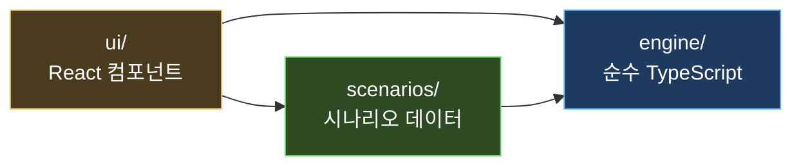
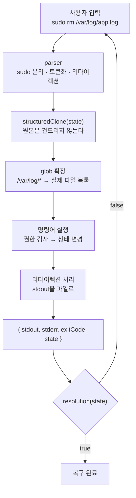

# 장애 대응 트러블슈팅 게임

브라우저 안의 가상 터미널에서 명령어를 입력하며, 일부러 망가뜨린 가상 서버의 **장애 원인을 찾고 복구하는 학습 게임**입니다.

정답을 알려주는 게임이 아니라 **사고 과정을 훈련하는 게임**입니다.
증상 확인 → 범위 좁히기 → 가설 → 검증 → 조치 → 재발 방지의 흐름을 13개 시나리오로 반복해서 익힙니다.

> **▶️ 플레이하기:** https://\<GitHub-사용자명\>.github.io/\<저장소명\>/
> *(저장소를 push하고 Settings → Pages → Source를 "GitHub Actions"로 바꾸면 자동 배포됩니다)*

```
ubuntu@web-01:~$ systemctl status nginx
× nginx.service - A high performance web server and a reverse proxy server
     Loaded: loaded (/lib/systemd/system/nginx.service; enabled; vendor preset: enabled)
     Active: failed (Result: exit-code) since Fri 2026-09-11 09:00:20 UTC; 14min 40s ago

Sep 11 09:00:00 web-01 nginx[1102]: open() "/var/log/nginx/access.log" failed (28: No space left on device)

ubuntu@web-01:~$ df -h
Filesystem Size Used Avail Use% Mounted on
/dev/root  8.0G 8.0G   19M 100% /
```

---

## 📸 스크린샷

| 시나리오 선택 | 장애 조사 | 결과 리포트 |
|---|---|---|
| *(스크린샷 자리)* | *(스크린샷 자리)* | *(스크린샷 자리)* |

*(플레이 GIF 자리 — 디스크 가득 참 시나리오를 처음부터 끝까지 푸는 30초 영상)*

---

## 왜 만들었나

인프라 공부를 하면서 가장 아쉬웠던 건, **장애를 겪어볼 기회가 없다**는 점이었습니다.
책으로 `df -h` 를 배워도, 실제로 디스크가 가득 찬 서버 앞에서 "무엇부터 봐야 하는지"는 배울 수 없습니다.

그렇다고 연습하려고 진짜 서버를 망가뜨릴 수도 없습니다. 그래서 만들었습니다.

- **안전합니다.** 실제 명령을 실행하는 코드가 한 줄도 없습니다. 전부 메모리 안의 가상 상태입니다.
- **현실적입니다.** 명령어 출력은 실제 리눅스/AWS CLI 형식을 그대로 따릅니다.
- **설치가 필요 없습니다.** 링크 하나로 바로 플레이합니다. 서버도 DB도 API 키도 없습니다.

---

## 시나리오 13개

| ID | 카테고리 | 난이도 | 증상 | 핵심 학습 |
|---|---|---|---|---|
| `linux-disk-full` | 리눅스 | 초급 | 웹사이트 접속 불가 | 원인을 없애도 서비스는 스스로 살아나지 않는다 |
| `linux-permission` | 리눅스 | 초급 | 403 Forbidden | 403은 서버가 살아 있다는 뜻이다 |
| `linux-port-conflict` | 리눅스 | 중급 | 재시작 후 기동 실패 | 원인과 증상 사이에 시간차가 있을 수 있다 |
| `linux-oom` | 리눅스 | 중급 | 앱이 반복해서 죽음 | 죽은 프로세스가 범인이 아닐 수 있다 |
| `network-firewall` | 네트워크 | 초급 | 밖에서만 접속 불가 | 서버 안 헬스체크는 이 장애를 못 잡는다 |
| `network-dns` | 네트워크 | 초급 | 외부 API 호출 실패 | 이름 해석 실패와 연결 실패는 다르다 |
| `network-bind-localhost` | 네트워크 | 중급 | 안에서만 됨 | 바인딩 주소가 접근 범위를 결정한다 |
| `web-nginx-config` | 웹/DB | 초급 | 설정 변경 후 다운 | restart와 reload의 차이 |
| `web-ssl-expired` | 웹/DB | 중급 | 브라우저 보안 경고 | 자동화를 믿지 말고 자동화를 감시하라 |
| `db-max-connections` | 웹/DB | 고급 | 특정 시간대만 500 | 스케일 아웃은 공짜가 아니다 |
| `aws-security-group` | AWS | 초급 | 새 EC2 접속 불가 | timeout과 refused의 차이 |
| `aws-alb-healthcheck` | AWS | 중급 | ALB가 503 반환 | 503은 "보낼 곳이 없다"는 뜻 |
| `aws-iam-s3` | AWS | 중급 | S3 업로드 실패 | AccessDenied 메시지를 끝까지 읽어라 |

각 시나리오는 **장애 티켓 → 조사 → 원인 제출 → 복구 조치 → 포스트모템** 순서로 진행되고,
3단계 힌트(방향 질문 → 볼 곳 제시 → 거의 정답)와 점수(시간·명령어 수·힌트·오답)를 제공합니다.

---

## 아키텍처

### 의존 방향은 한 방향으로만 흐른다



`engine/`은 React를 전혀 모릅니다. 그래서 **브라우저 없이 Vitest로 전부 테스트할 수 있습니다.**
게임 규칙(점수·힌트·클리어 판정)도 React 컴포넌트가 아니라 엔진에 있습니다.

### 명령어 한 줄이 처리되는 길



### 폴더 구조

```
src/
  engine/          # 순수 TypeScript. React를 절대 import 하지 않는다
    state/         #   상태 모델 + 파생값 계산 + 서비스 규칙 + 장애 주입
    parser/        #   입력 문자열 → 명령어 + 인자
    commands/      #   명령어 구현 (1파일 = 관련 명령어 묶음)
    judge/         #   복구 판정 헬퍼
    session/       #   세션과 점수
  scenarios/       # 시나리오 데이터 파일 (1파일 = 1시나리오)
  ui/              # React 컴포넌트
tests/             # Vitest (175개)
```

---

## 설계에서 중요하게 생각한 것

### 1. 명령어 출력을 시나리오에 하드코딩하지 않는다

이 프로젝트에서 가장 중요한 원칙입니다.

시나리오는 **초기 상태 + 장애 주입**만 정의하고, `df -h` 같은 출력은 **그때의 상태를 읽어서 계산**합니다.

```ts
// df의 사용량 = 기본 사용량 + 그 마운트에 속한 모든 파일 크기의 합
const usedKB = disk.reservedKB + fileKB;
```

그래서 플레이어가 로그 파일을 지우면 `df -h` 결과가 **저절로** 100% → 26%로 바뀝니다.
이 원칙이 없으면 "조치를 했는데 출력이 그대로"인 가짜 게임이 됩니다.

| 명령어 | 저장된 값이 아니라… | 이렇게 계산 |
|---|---|---|
| `df -h` | 사용량을 저장 ✕ | 기본 사용량 + 파일 크기 합 |
| `ss -tlnp` | 포트 목록을 저장 ✕ | 프로세스가 연 리스닝 소켓 |
| `free -m` | 사용량을 저장 ✕ | 기본 사용량 + 프로세스 메모리 합 |
| `curl` | 응답을 저장 ✕ | DNS → 방화벽 → 리스닝 → TLS → 권한 |

### 2. "서비스가 왜 못 뜨는가"는 엔진이 판단한다

시나리오 어디에도 "nginx가 실패한다"는 코드가 없습니다.
시나리오는 5.9GB 로그 파일 하나를 놓아둘 뿐이고, 엔진이 공통 규칙으로 판단합니다.

1. 디스크 여유 부족 → `No space left on device`
2. 포트 점유 → `Address already in use`
3. 설정 문법 오류 → `[emerg] ... is not terminated by ";"`

덕분에 플레이어가 원인을 없애면 **시나리오를 고치지 않아도** 서비스가 정상적으로 뜹니다.

### 3. 네트워크는 요청 체인 하나로 통일했다

`curl`, `ping`, `dig`를 따로 만들지 않고 하나의 경로를 통과시킵니다.

```
이름 해석 → 로컬/원격 판별 → 방화벽 → 리스닝 확인 → TLS 확인 → 권한 확인
```

각 단계가 실패하면 **실제 curl의 에러 코드**를 냅니다 — `(6)` DNS, `(7)` 거부, `(28)` 타임아웃, `(60)` 인증서.
그리고 **로컬 연결은 방화벽을 거치지 않게** 했습니다. 이 한 줄 덕분에 "서버 안에서는 되는데 밖에서는 안 되는" 상황이 하드코딩 없이 자연스럽게 생깁니다.

### 4. 라이브러리를 쓰지 않았다

런타임 의존성은 `react`, `react-dom` **두 개뿐**입니다.

- **라우터 ✕** — 화면이 4개뿐이라 `useState` 하나로 충분합니다. GitHub Pages 하위 경로 문제도 피합니다.
- **상태 관리 라이브러리 ✕** — 세션이 하나뿐입니다.
- **immer ✕** — `structuredClone`으로 복사 후 수정합니다. 브라우저 기본 제공이고, "복사 → 고침 → 반환"이 읽기에도 가장 명확합니다.
- **CSS 프레임워크 ✕** — CSS 변수 몇 개로 충분합니다.

### 5. 새 시나리오는 파일 하나만 추가하면 된다

엔진을 고쳐야만 추가되는 시나리오가 나오면, 그건 **엔진이 충분히 일반적이지 않다는 신호**입니다.
시나리오에 특수 분기를 넣는 대신 엔진을 일반화했습니다. → [시나리오 추가 가이드](docs/SCENARIO_GUIDE.md)

---

## 테스트

```bash
npm test
```

**175개 테스트** 중 핵심은 시나리오 자동 검증입니다. 시나리오 13개를 순회하며 검사합니다.

1. 장애 주입 직후 `resolution`이 `false`인가
2. `solutionPath`를 순서대로 실행하면 `resolution`이 `true`가 되는가
3. 모범 풀이에 `command not found`, `No such file` 같은 실패 신호가 없는가
4. 스키마가 유효한가 (힌트 3개, 정답이 보기 안에 있는지, 오답에 해설이 있는지)

**풀 수 없는 시나리오는 CI에서 실패합니다.** 이 테스트가 실제로 개발 중에 버그 3개를 잡았습니다.

- `httpResponds`가 403 응답을 "정상"으로 판정하던 문제
- `portIsListening("0.0.0.0", …)`이 `127.0.0.1` 바인딩을 통과시키던 문제
- 프리셋 설정이 조용히 누락되어 시나리오를 풀 수 없게 된 문제

---

## 기술 스택

| 분류 | 선택 | 이유 |
|---|---|---|
| 빌드 | Vite | 빠르고 설정이 적다 |
| 언어 | TypeScript (strict) | 상태 모델이 복잡해 타입이 곧 문서가 된다 |
| UI | React 19 | 상태 → 화면 매핑이 단순해진다 |
| 테스트 | Vitest | Vite와 설정을 공유한다 |
| 배포 | GitHub Pages + Actions | 서버 없이 링크 하나로 공유 |
| 저장 | localStorage | 진행 상황만 저장. 실패해도 게임은 정상 동작 |

---

## 로컬에서 실행하기

```bash
git clone <저장소 주소>
cd <저장소 폴더>
npm install
npm run dev
```

브라우저에서 http://localhost:5173 을 엽니다.

```bash
npm test        # 테스트 실행
npm run typecheck   # 타입 검사
npm run build       # 배포용 빌드 (dist/)
```

---

## 기여하기

시나리오를 추가하는 건 **파일 하나를 만드는 일**입니다. 엔진 코드를 고칠 필요가 없습니다.

자세한 방법과 템플릿은 **[docs/SCENARIO_GUIDE.md](docs/SCENARIO_GUIDE.md)** 를 봐주세요.

---

## 앞으로 하고 싶은 것

- 모니터링 대시보드 화면 (CPU/메모리/에러율 그래프로 단서 제공)
- 여러 장애가 동시에 발생하는 복합 시나리오
- AI가 소크라테스식으로 힌트를 주는 모드
- 실제 Docker 컨테이너 실습 모드

엔진 구조는 이런 확장을 염두에 두고 만들었습니다.
장애 주입(fault)은 배열이라 여러 개를 겹칠 수 있고, 상태 모델에는 시뮬레이션 시각(clock)이 있습니다.
