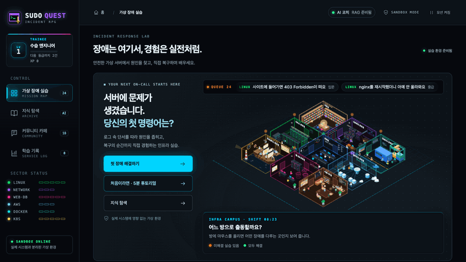
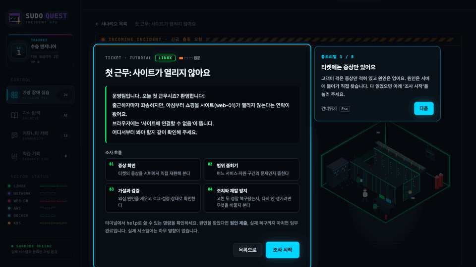
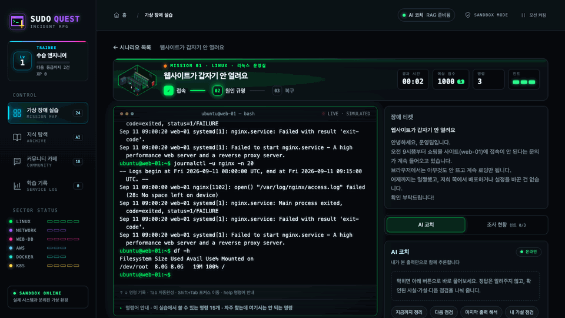

# SUDO QUEST — 인프라 장애 대응 퀘스트

> Fix broken virtual servers in a browser terminal, with an AI coach grounded in official documentation.

장애 티켓을 읽고 가상 CLI로 서버를 조사·복구하는 학습 게임입니다. 명령은 브라우저의 가상 상태만 바꾸며 실제 시스템에서 실행되지 않습니다.



**현재 상태:** 로컬 실행 가능 · 공개 배포 준비 중. 게임은 정적 화면만으로 실행할 수 있고, AI 코치·지식 탐색·게시판에는 별도의 FastAPI 서버가 필요합니다.

## 직접 해보기

```bash
npm ci
npm run dev
```

브라우저에서 `http://127.0.0.1:5173`을 엽니다. 백엔드와 API 키 설정은 [실행 안내](docs/RUNNING.md)를 참고하세요. 키는 `backend/.env`에만 두며 브라우저 빌드에 넣지 않습니다.

| 처음 배우기 | 조사 중 코치 |
|---|---|
|  |  |
| 별도 연습 실습으로 기본 조사 흐름을 익힙니다. | 플레이어가 본 출력만 전달하고 숨겨진 정답은 보내지 않습니다. |

## 무엇을 만들었나

- **24개 장애 실습:** Linux·네트워크·웹/DB·AWS·Docker·Kubernetes. 티켓의 증상에서 시작해 원인 제출과 실제 복구를 모두 마쳐야 클리어합니다.
- **가상 명령 엔진:** 파일·디스크·프로세스·서비스 등의 상태를 공유합니다. 예를 들어 로그 파일을 정리하면 `df -h`의 사용량이 다시 계산되고, 공간을 확보한 뒤 서비스를 재시작할 수 있습니다.
- **학습 리포트:** 명령과 출력을 되짚고, 원인·조치·재발 방지를 기록합니다. 점수는 시간이나 명령 횟수가 아닌 힌트와 오답에 영향을 받습니다.
- **근거 기반 코치:** FastAPI RAG가 공식 문서를 검색하고 인용 번호를 검증합니다. 게시판은 SQLite에 저장됩니다.

구조는 `src/ui → src/scenarios → src/engine`으로 흐릅니다. 순수 TypeScript 엔진은 React 없이 테스트할 수 있습니다. [전체·가상 CLI·RAG 파이프라인 그림](docs/submission/PIPELINES.md) · [엔진 설계](docs/ENGINE_DESIGN.md) · [시나리오 추가 가이드](docs/SCENARIO_GUIDE.md) · [RAG 설계 결정](docs/infra-coach/adr/README.md)

## 검증과 한계

- 2026-10-23 로컬 검사: 프론트엔드 **957개**, 백엔드 **87개** 통과; 타입 검사·빌드 통과. 모든 시나리오의 복구 경로와 정답 밖 탐색, 백엔드의 인용·정답 정보 차단·장애 처리를 포함합니다.
- [RAG 평가 v2](docs/infra-coach/22_RAG_근거_보강.md)는 24문항에서 답변 성공 23건을 기록했습니다. 표본이 작고 개발 도우미가 채점했으며, 평가 모델도 공개 운영 예정 모델과 다릅니다. 일반적인 정확도 수치로 해석하지 않습니다.
- 정답 데이터는 브라우저에 포함되므로 경쟁용 순위 판정에는 적합하지 않습니다. 백엔드가 꺼지면 게임은 가능하지만 코치·지식 답변·게시판은 사용할 수 없습니다.

[화면 사진](docs/assets/readme/) · [데이터 출처와 라이선스](docs/DATA_SOURCES.md) · [과제 제출 문서](docs/submission/README.md)

## 만든 사람

- **Choi:** 기획·요구사항 결정
- **Claude:** 가상 엔진, 실습, UI, RAG와 평가 작업
- **GPT (Codex):** Kubernetes 초기 실습, 정답 밖 탐색 점검, 퀘스트 연출

구체적인 작업 기록은 [인수인계 문서](docs/infra-coach/HANDOFF.md)에 남겨 두었습니다.
