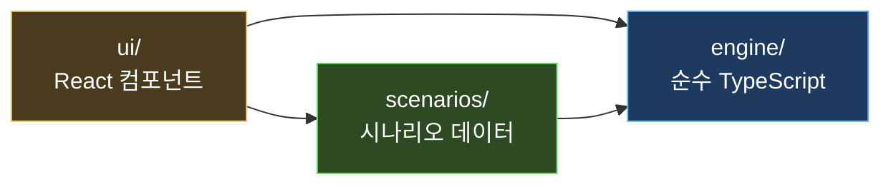
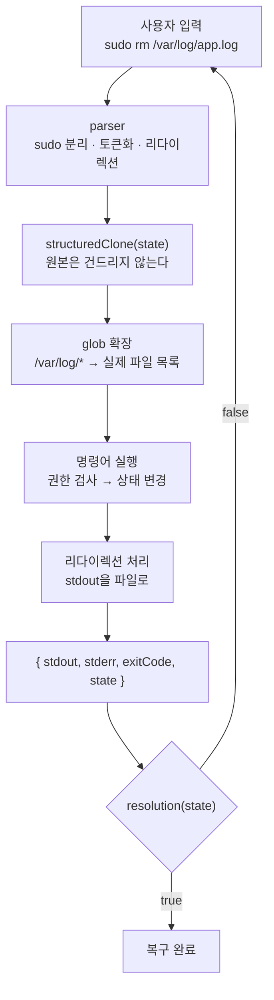

# 가상 엔진 설계

README에서 옮긴 게임 엔진의 구조와 설계 원칙입니다. 번들 크기 표는 옮긴 시점(2026-10-22)의 값이고, 지금 값은 `npm run build` 출력을 보세요.

## 1. 구조

### 의존 방향은 한 방향으로만 흐른다



`engine/`은 React를 전혀 모릅니다. 그래서 **브라우저 없이 Vitest로 전부 테스트할 수 있습니다.**
게임 규칙(점수·힌트·클리어 판정)도 React 컴포넌트가 아니라 엔진에 있습니다.

### 명령어 한 줄이 처리되는 길



### 폴더 구조

```
src/
  engine/          # 순수 TypeScript. React를 절대 import 하지 않는다
    state/         #   상태 모델 + 파생값 계산 + 서비스 규칙 + 장애 주입
    parser/        #   입력 문자열 → 명령어 + 인자
    commands/      #   명령어 구현 (1파일 = 관련 명령어 묶음)
    judge/         #   복구 판정 헬퍼
    session/       #   세션과 점수
  scenarios/       # 시나리오 데이터 파일 (1파일 = 1시나리오)
  ui/              # React 컴포넌트
tests/             # Vitest
```

---

## 2. 설계에서 중요하게 생각한 것

### 1. 명령어 출력을 시나리오에 하드코딩하지 않는다

이 프로젝트에서 가장 중요한 원칙입니다.

시나리오는 **초기 상태 + 장애 주입**만 정의하고, `df -h` 같은 출력은 **그때의 상태를 읽어서 계산**합니다.

```ts
// df의 사용량 = 기본 사용량 + 그 마운트에 속한 모든 파일 크기의 합
const usedKB = disk.reservedKB + fileKB;
```

그래서 플레이어가 로그 파일을 지우면 `df -h` 결과가 **저절로** 100% → 26%로 바뀝니다.
이 원칙이 없으면 "조치를 했는데 출력이 그대로"인 가짜 게임이 됩니다.

| 명령어 | 저장된 값이 아니라… | 이렇게 계산 |
|---|---|---|
| `df -h` | 사용량을 저장 ✕ | 기본 사용량 + 파일 크기 합 |
| `ss -tlnp` | 포트 목록을 저장 ✕ | 프로세스가 연 리스닝 소켓 |
| `free -m` | 사용량을 저장 ✕ | 기본 사용량 + 프로세스 메모리 합 |
| `curl` | 응답을 저장 ✕ | DNS → 방화벽 → 리스닝 → TLS → 권한 |

### 2. "서비스가 왜 못 뜨는가"는 엔진이 판단한다

시나리오 어디에도 "nginx가 실패한다"는 코드가 없습니다.
시나리오는 5.9GB 로그 파일 하나를 놓아둘 뿐이고, 엔진이 공통 규칙으로 판단합니다.

1. 디스크 여유 부족 → `No space left on device`
2. 포트 점유 → `Address already in use`
3. 설정 문법 오류 → `[emerg] ... is not terminated by ";"`

덕분에 플레이어가 원인을 없애면 **시나리오를 고치지 않아도** 서비스가 정상적으로 뜹니다.

### 3. 네트워크는 요청 체인 하나로 통일했다

`curl`, `ping`, `dig`를 따로 만들지 않고 하나의 경로를 통과시킵니다.

```
이름 해석 → 로컬/원격 판별 → 방화벽 → 리스닝 확인 → TLS 확인 → 권한 확인
```

각 단계가 실패하면 **실제 curl의 에러 코드**를 냅니다 — `(6)` DNS, `(7)` 거부, `(28)` 타임아웃, `(60)` 인증서.
그리고 **로컬 연결은 방화벽을 거치지 않게** 했습니다. 이 한 줄 덕분에 "서버 안에서는 되는데 밖에서는 안 되는" 상황이 하드코딩 없이 자연스럽게 생깁니다.

### 4. 라이브러리를 쓰지 않았다

런타임 의존성은 `react`, `react-dom` **두 개뿐**입니다.

- **라우터 ✕** — 해시 주소(`#/mission/3/play`) 몇 개뿐이라 작은 `route.ts`로 충분합니다. 서버 라우팅이 없는 GitHub Pages에서도 동작합니다.
- **상태 관리 라이브러리 ✕** — 세션이 하나뿐입니다.
- **immer ✕** — `structuredClone`으로 복사 후 수정합니다. 브라우저 기본 제공이고, "복사 → 고침 → 반환"이 읽기에도 가장 명확합니다.
- **CSS 프레임워크 ✕** — CSS 변수 몇 개로 충분합니다.

### 5. 새 시나리오는 파일 하나만 추가하면 된다

엔진을 고쳐야만 추가되는 시나리오가 나오면, 그건 **엔진이 충분히 일반적이지 않다는 신호**입니다.
시나리오에 특수 분기를 넣는 대신 엔진을 일반화했습니다. → [시나리오 추가 가이드](SCENARIO_GUIDE.md)

### 6. 첫 화면에는 명령 구현을 싣지 않는다

홈(캠퍼스)은 시나리오 목록만 있으면 되고, 명령 구현(엔진 실행부)은 실습 터미널에서만 필요합니다. 그래서 번들을 나눴습니다.

| 조각 | 크기(gzip) | 언제 받나 |
|---|---|---|
| 본체(`index`) | 317kB (103kB) | 첫 화면 |
| `react-vendor` | 222kB (69kB) | 첫 화면, 배포해도 거의 안 바뀌어 캐시 재사용 |
| `execute`(명령 실행 엔진) + `PlayScreen` | 106kB + 20kB | 실습에 처음 들어갈 때 |
| `CommunityScreen` | 18kB | 게시판에 처음 들어갈 때 |

분할 전에는 665kB 한 덩어리였습니다. 시나리오가 명령 이름 목록(`engine/commands/names.ts`)만 쓰게 하고, 세션의 명령 실행(`engine/session/execute.ts`)을 따로 떼어 실습 화면과 함께 불러옵니다. 새로고침하면 저장해 둔 입력을 다시 실행하는 부분(`ui/sessionReplay.ts`)도 저장본이 있을 때만 불러옵니다.

## 3. 테스트

```bash
npm test
```

프론트 테스트(Vitest) 중 핵심은 시나리오 자동 검증입니다. 시나리오 24개와 튜토리얼 연습 실습을 순회하며 검사합니다.

1. 장애 주입 직후 `resolution`이 `false`인가
2. `solutionPath`를 순서대로 실행하면 `resolution`이 `true`가 되는가
3. 모범 풀이에 `command not found`, `No such file` 같은 실패 신호가 없는가
4. 스키마가 유효한가 (힌트 3개, 정답이 보기 안에 있는지, 오답에 해설이 있는지)

**풀 수 없는 시나리오는 CI에서 실패합니다.** 이 테스트가 실제로 개발 중에 버그 3개를 잡았습니다.

- `httpResponds`가 403 응답을 "정상"으로 판정하던 문제
- `portIsListening("0.0.0.0", …)`이 `127.0.0.1` 바인딩을 통과시키던 문제
- 프리셋 설정이 조용히 누락되어 시나리오를 풀 수 없게 된 문제

정답 경로 밖의 입력도 검사합니다. `tests/scenario-exploration.*`는 모든 실습에서 조회 반복·역순 조사·무관한 조치·대체 풀이를 실행합니다. `tests/exploration-regressions.test.ts`는 dry-run의 상태 변경, UDP 규칙의 TCP 오복구, 잘못된 CIDR·ARN·숫자·옵션·셸 문법을 검사합니다. 범위와 한계는 [탐색 점검 기록](infra-coach/14_시나리오_탐색_점검.md)을 참고하세요.
