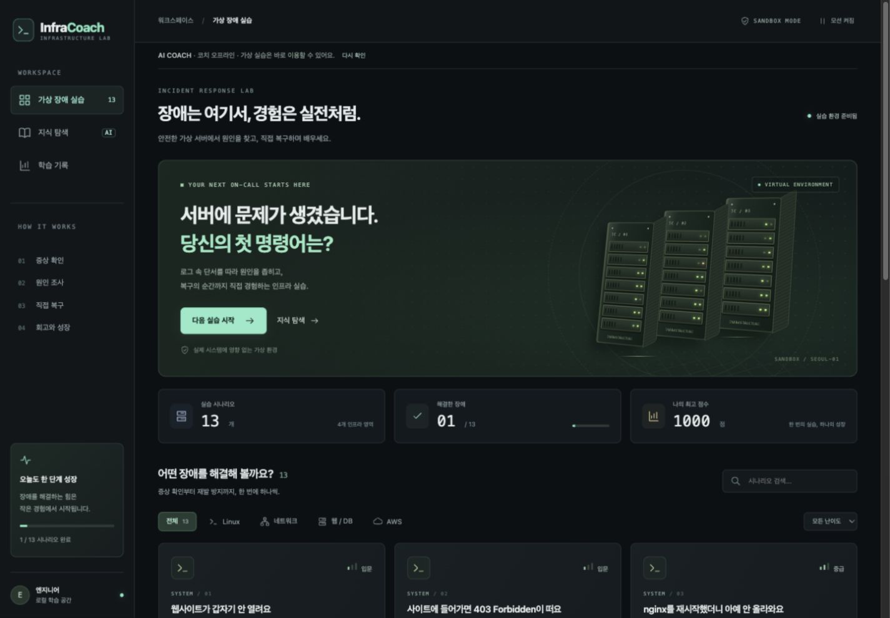
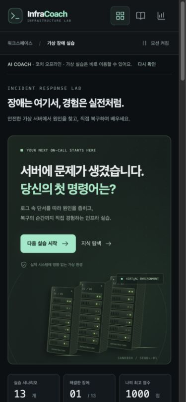

# 서버실 UI 초안 및 프론트엔드 안정화

작업일: 2026-10-21 · 로컬 피드백용 초안

## 구조 확인

README, CLAUDE, PROJECT/HANDOFF/TASKS, 기획서, 구현 명세서, 시나리오 가이드, backend README를 기준으로 현재 코드를 확인했다. 초기 게임의 서버/API 미사용 규칙은 이후 RAG 확장으로 변경되어 있으며 최신 구현과 인수인계를 우선했다.

- `src/engine`: 순수 TypeScript 가상 시스템, 명령 처리, 복구/점수 판정. 이번 작업에서 규칙 변경 없음.
- `src/scenarios`: 13개 장애 시나리오. 원본 정답/풀이 데이터 유지.
- `src/ui`: React 화면·진행 저장·터미널. 이번 디자인 작업의 중심.
- `src/api`: 서버 요청 계약. health 응답의 런타임 검증 보강.
- `backend/app`: FastAPI, 지식 검색/조건 탐색/코치, LangGraph, Chroma. 이번 서버 로직 변경 없음.
- `backend/catalog`: 공식 문서 기반 지식 항목 100건과 문서 목록.

## 제작한 화면

검정/녹색 계열의 관제실을 중심으로 민트색 액션과 서버 랙을 배치했다. 서버 랙은 CSS로 생성하며 외부 이미지나 라이브러리를 추가하지 않았다. LED 깜박임, 랙 부유, 패킷 이동, 카드 등장/호버를 포함한다. 화면 상단 모션 정지와 OS `prefers-reduced-motion`을 지원한다.

시나리오 분류, 제목/ID 검색, 난이도 필터, 빈 결과 안내, 다음 미해결 실습 추천, 학습 기록 및 기록 초기화 확인 UI를 추가했다. 코치/지식 기능과 실습 결과 리포트는 기존 흐름을 보존한다. 장식용 서버 랙은 실제 서버 메트릭이나 장애 정답을 표현하지 않는다.

## 환경 설정

`npm run setup:env`가 루트 `.env`와 `backend/.env`를 예제로부터 생성한다. 이미 존재하는 파일은 건드리지 않으며 새 파일은 소유자 읽기/쓰기 권한으로 만든다. 로컬에서 두 번 실행해 기존 파일 보존 메시지를 확인했고 `git check-ignore`로 두 파일이 제외됨을 확인했다.

사용자가 키를 넣을 곳은 **`backend/.env`의 `GMS_KEY`**다. 루트 `.env`에는 개발 프록시 주소만 둔다. Mac/Linux Python 3.11 기준 준비 명령은 `backend/README.md`에 추가했다. 실제 API 호출과 색인은 별도 작업이다.

## 안정화 및 검증

| 변경 | 확인 |
|---|---|
| 저장 데이터 구조/점수/시각 검증 | 손상 JSON, 배열, 누락 필드, 문자열 점수, 범위 밖 점수 제외; 정상 기록 보존 |
| 저장 실패 허용 | 저장 공간이 막혀도 완료 기록 반환; 기존 최고 점수 보존 |
| health 응답 검증 | 공급자 missing/configured/verified, index counts, rag_status 검사; 잘못된 응답은 연결 오류 처리 |
| 원인 보기 셔플 | 원본 보존, 판마다 셔플, 같은 판 내 재개 시 순서 유지 |
| 원인 모달 | native dialog 사용, Escape 닫기와 포커스 복귀 |
| 터미널 입력 | IME 조합 중 Enter 무시, 빈 입력 Tab/Shift+Tab으로 포커스 이동 |
| 화면 이동 | 이전 화면의 하단 스크롤 위치가 다음 화면에 남지 않도록 상단 복귀 |
| 의존성 | Vite 7.3.7, Vitest 4.1.12, source-map-js 1.2.2; npm audit 0건 |

실제 실행:

- `npm test`: **9개 파일, 214개 테스트 통과** (기존 197 + 회귀 17).
- `npm run typecheck`, `npm run build`: 통과.
- `npm audit --json`: 취약점 0건.
- 브라우저: AWS+입문 필터 1건, 없는 검색어 0건, 필터 초기화, 모바일 nginx 검색 2건.
- 브라우저: 디스크 장애에서 `systemctl status nginx`, `df -h`, `sudo rm /var/log/app/app.log`, `sudo systemctl restart nginx` 실행, 원인 제출 → S/1000점, 학습 기록에 반영.
- 브라우저: 원인 모달 Escape 및 재개 시 순서 유지, 코치 서버 오프라인에서도 게임 동작, 지식 화면 재연결 안내.
- 반응형: 1440×1000 및 390×844 설정에서 문서 콘텐츠 폭과 뷰포트 폭 일치(가로 넘침 없음).

## 남은 확인

이 Mac에서 Python 백엔드 설치/테스트, 실제 GMS 응답, 데이터 수집/색인은 미실행이다. 키는 입력하지 않았다. 개발 도구 취약점 0건은 애플리케이션 전체 보안 감사를 의미하지 않는다. UI 디자인에 대한 사용자 피드백과 나머지 TASKS는 후속 작업으로 남긴다.
