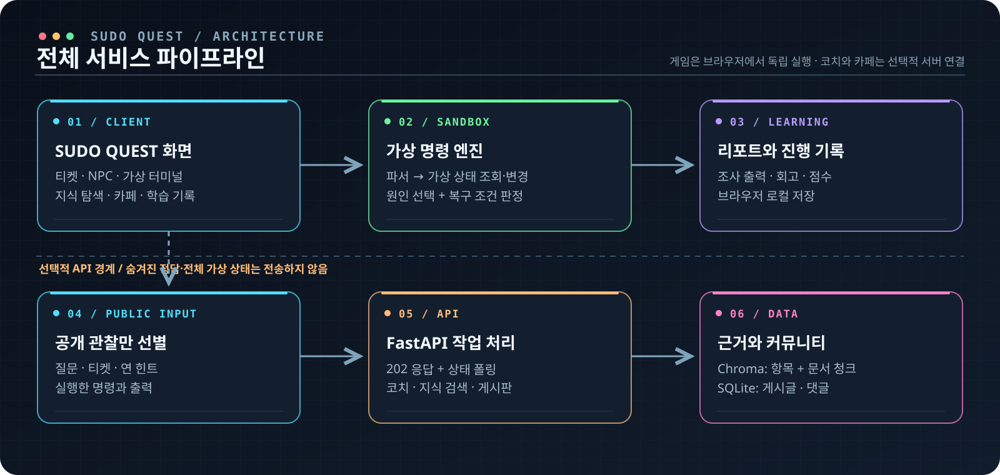
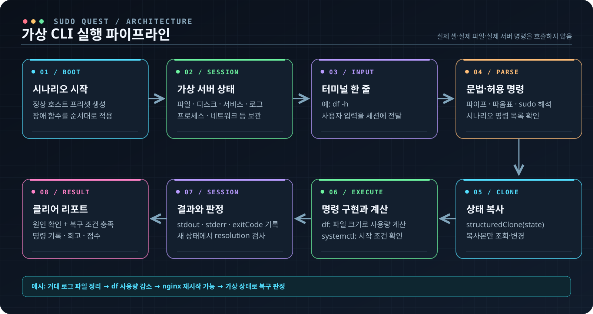
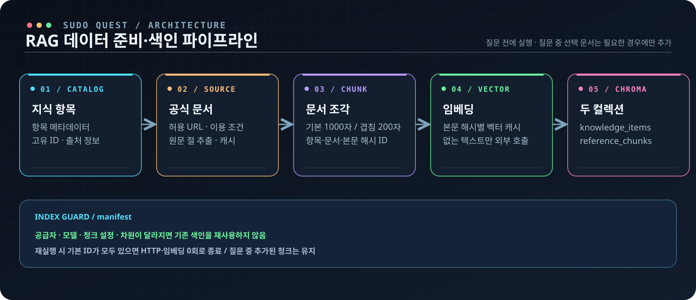
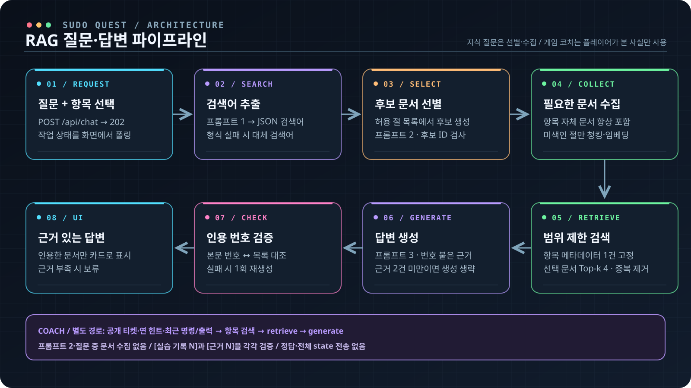

# SUDO QUEST 작동 원리와 파이프라인

브라우저 게임과 AI 코치는 서로 다른 실행 경로다. **가상 CLI는 서버 없이 브라우저에서 동작**한다. 코치·지식 탐색·게시판을 사용할 때만 FastAPI에 접속한다. 아래 그림은 구현 구조를 요약한 것이며 서버 랙 장식이나 애니메이션을 실제 감시 데이터로 표현하지 않는다.

그림 원본을 크게 보려면 [전체 흐름](../assets/pipelines/overview.svg) · [가상 CLI](../assets/pipelines/virtual-cli.svg) · [RAG 색인](../assets/pipelines/rag-index.svg) · [RAG 답변](../assets/pipelines/rag-answer.svg)을 연다.

| 경로 | 데이터와 책임 | 서버가 꺼지면 |
|---|---|---|
| 게임 | React 화면 → TypeScript 시나리오·명령 엔진 → 브라우저 진행 기록 | 계속 플레이 가능 |
| AI | 공개 질문·관찰 기록 → FastAPI → RAG 코치·지식 답변 → 인용 카드 | 코치·지식 답변 이용 불가 |
| 커뮤니티 | 게시글·댓글 요청 → FastAPI → SQLite | 게시판 이용 불가 |

## 1. 가상 CLI: 입력이 어떻게 화면과 서버 상태를 바꾸는가

1. **시나리오 초기화.** [시나리오 빌더](../../src/engine/scenario/build.ts)가 정상 호스트 프리셋에 장애 함수 `faults`를 순서대로 적용한다. 파일·디스크·서비스·프로세스·로그·네트워크 같은 데이터는 [SystemState](../../src/engine/state/types.ts) 안의 *가상 객체*다. Linux뿐 아니라 Docker·Kubernetes·AWS 명령도 이 상태의 해당 모델을 조회하거나 수정한다.
2. **한 줄 입력과 구문 처리.** [실행기](../../src/engine/run.ts)가 문법 오류를 검사하고 파이프(`|`)로 나눈 다음, 각 단계를 따옴표·`sudo`·리다이렉션(`>`/`>>`)을 고려해 파싱한다. `*` 글롭은 가상 파일 트리에서 확장한다. 시나리오가 허용한 명령 목록에 없는 이름은 `command not found`로 끝나며 실제 셸로 전달되지 않는다.
3. **복사본에서 명령 실행.** `structuredClone(state)`로 만든 새 상태에 [명령 구현](../../src/engine/commands/index.ts)을 적용한다. 예를 들어 파일 삭제·비우기는 `sizeKB`를 바꾸고, [`df`](../../src/engine/state/derived.ts)의 사용량은 파일 크기와 예약 공간에서 다시 계산된다. `systemctl start`는 현재 자원·설정 조건을 확인하므로, 공간 부족을 해결하기 전과 후의 결과가 다를 수 있다.
4. **셸처럼 연결, 그러나 제한된 문법.** 파이프 앞 단계의 `stdout`이 다음 단계의 `stdin`이 된다. 각 단계의 `stderr`는 모으고 종료 코드는 마지막 단계의 값을 쓴다(`pipefail` 없음). 리다이렉션 파일은 `sudo` 명령 자체가 아닌 호출한 셸 사용자의 권한으로 연다. 실제 Bash 전체 문법을 구현한 것은 아니다. 명령 구현에서 예외가 나면 그 한 줄의 변경을 버리고 사용자용 시뮬레이터 오류를 표시한다.
5. **기록과 클리어.** [세션 실행](../../src/engine/session/execute.ts)은 입력·출력·오류·종료 코드·당시 작업 디렉터리를 기록한다. [클리어 판정](../../src/engine/session/session.ts)은 **올바른 원인 제출**과 **시나리오의 `resolution(state)` 충족**을 모두 요구한다. 어느 쪽을 먼저 해도 된다. 그 뒤 명령 기록과 회고가 리포트에 반영된다.

예를 들어 [첫 디스크 장애](../../src/scenarios/linux-disk-full.ts)는 다음 상태 전이를 보여 준다.

| 플레이어 입력 | 엔진이 실제로 읽거나 바꾸는 것 | 이어서 관찰할 수 있는 결과 |
|---|---|---|
| `systemctl status nginx`, `journalctl -u nginx` | 가상 서비스 상태와 저장된 로그 | 서비스 실패와 `No space left on device` 단서 |
| `df -h`, `du -sh /var/log/*` | 가상 파일 `sizeKB`와 디스크 예약량으로 사용량 계산 | 전체 공간 부족과 큰 로그 경로를 좁힘 |
| `sudo rm /var/log/app/app.log` | 가상 파일 트리에서 해당 로그 제거 | 재실행한 `df -h`의 사용량 감소 |
| `sudo systemctl restart nginx` | 현재 디스크·서비스 조건으로 시작 시도 | 서비스가 살아나면 복구 조건의 나머지 부분 충족 |

이 실습의 복구 조건은 **루트 디스크 사용률 90% 미만 + nginx 활성**이다. 원인 보기까지 맞혀야 클리어된다. 미리 정해진 정답 명령 문자열과 입력을 비교하는 방식이 아니므로 유효한 다른 조사 순서도 시도할 수 있다. 다만 지원 명령과 옵션은 시나리오별로 한정되며, 열린 파일 핸들 같은 실제 OS의 모든 세부 동작을 재현하지는 않는다.

**경계:** 게임 명령은 `child_process`·실제 터미널·호스트 파일시스템을 호출하지 않는다. 코치 요청 빌더는 티켓, 이미 연 힌트, 최근 명령과 출력 등 관찰 정보만 보낸다. 최근 관찰은 최대 30건, 각 출력은 앞뒤를 남기며 길이를 제한하고, 대화도 최근 6건만 보낸다. `faults`, `answerId`, `solutionPath`, 전체 `state`는 요청에 넣지 않으며 백엔드 계약도 비공개 필드를 거부한다. 관련 코드는 [요청 빌더](../../src/api/coach.ts), [서버 계약](../../backend/app/contracts.py), [엔진 설계](../ENGINE_DESIGN.md)에 있다. 다만 게임 판정 코드와 정답 데이터는 브라우저 번들에 있으므로 악의적인 사용자를 상대로 한 비공개 정답 저장소나 경쟁용 채점 서버는 아니다.

## 2. RAG 준비: 질문 전에 무엇을 색인하는가

| 단계 | 입력 → 출력 | 중복·오염 방지 |
|---|---|---|
| 카탈로그 | 주제별 제목·제품·오류 코드·증상·출처 메타데이터 | 항목마다 고유 `item_id` |
| 수집 | 등록된 공식 문서 URL → 필요한 절의 본문 | 허용 URL만 요청, robots·호스트 간격·원문 캐시 확인 |
| 청킹 | 절 본문 → 검색용 조각 | 기본 **1000자, 겹침 200자**. 항목·문서·본문 해시·순번으로 ID 구성 |
| 임베딩 | 조각 텍스트 → 벡터 | 공급자·모델·텍스트 해시별 캐시; 없는 텍스트만 호출 |
| 저장 | Chroma `knowledge_items` + `reference_chunks` | 전자는 항목 메타데이터, 후자는 `item_id`가 붙은 문서 청크 |

[색인 코드](../../backend/app/corpus.py)는 공급자·모델·임베딩 차원·청크 설정·코퍼스 해시를 manifest와 대조한다. 설정이 바뀐 색인을 무심코 재사용하지 않고, 기본 ID가 이미 있으면 다시 수집·임베딩하지 않는다. 질문 중 새로 선택된 문서는 그때 필요한 절만 추가 색인한다. 따라서 **항목 수와 청크 수는 같을 필요가 없다.** 2026-10-23 로컬 health 확인에서는 항목 131건, 청크 308건이었다. 이는 그 시점의 로컬 색인 상태이며 고정 성능 지표가 아니다.

## 3. RAG 답변: 검색어부터 근거 카드까지

1. **요청과 작업 상태.** UI가 `POST /api/chat`으로 질문과 선택한 지식 항목을 보내면 API는 `202`와 작업 ID를 반환한다. 화면은 `/api/jobs/{job_id}`를 폴링해 단계와 결과를 보여 준다. 답변·검색어·문서 선정에는 캐시가 있어 반복 질문 비용을 줄인다. ([API](../../backend/app/main.py), [RAG](../../backend/app/rag.py))
2. **검색어 생성.** `SEARCH` 프롬프트가 한국어 질문을 문서 검색에 쓸 기술 용어·오류 코드가 담긴 JSON으로 바꾼다. 형식이 틀리면 항목 원제와 질문을 이용한 대체 검색어를 쓴다. ([프롬프트](../../backend/app/prompts.py))
3. **후보 선별.** 등록된 공식 페이지의 *절 카탈로그*에서 검색어와 맞는 제목·요약·제품 후보를 찾는다. `SELECT` 프롬프트에는 원문 전체가 아닌 후보 정보만 보여 주고 선정·제외 이유를 받는다. 후보 밖 ID는 거부하며 항목 자체 문서는 항상 포함한다. 이미 선택했던 검색어 조합은 캐시를 사용한다. ([선별](../../backend/app/discovery.py))
4. **필요한 절만 색인.** 선별된 문서 중 해당 항목에 아직 색인되지 않은 절만 수집·청킹·임베딩한다. 허용 출처 밖 URL이나 다른 항목의 청크가 섞이지 않도록 제한한다.
5. **근거 검색.** LangGraph는 `retrieve → generate` 두 노드다. `retrieve`는 **선택 항목의 메타데이터를 1번 근거로 고정**하고, 질문+검색어 벡터로 선별 문서의 청크를 `item_id`·`doc_id` 조건 안에서 Top-k(기본 4) 검색한다. URL과 본문 해시가 같은 결과는 합치고 각 근거에 번호를 붙인다. 검색어 생성·선별·추가 색인은 이 그래프의 *앞*에서 수행된다. ([그래프](../../backend/app/graphs.py), [검색](../../backend/app/rag.py))
6. **생성과 인용 검증.** 근거가 메타데이터를 포함해 2건 미만이면 문서 근거 부족을 알리고 생성을 생략한다. 그렇지 않으면 `ANSWER` 프롬프트가 번호 붙은 근거로 답한다. 코드가 답변 본문·제안 점검의 `[근거 N]`과 `cited_evidence_ids`의 일치 및 실제 근거 존재를 검사한다. 실패 시 한 번 재생성하고, 다시 실패하면 오류로 처리한다. UI에는 **실제로 인용한 근거만** 카드로 반환한다. 인용이 없으면 안내 문구를 표시한다.

### 실습 코치는 왜 별도 경로인가

게임의 `POST /api/coach`는 일반 지식 질문과 달리 **플레이어가 본 사실**만 받는다. [코치](../../backend/app/coach.py)는 필요하면 항목을 찾고 문서 청크를 검색하지만, 지식 질문의 `SELECT` 프롬프트나 질문 중 추가 수집은 사용하지 않는다. 모델에는 관찰을 `[실습 기록 N]`, 문서를 `[근거 N]`으로 구분해 주고, 두 번호 집합을 각각 검증한다. 지원하지 않는 가상 명령을 무심코 제안하지 않도록 명령 목록도 함께 보낸다. 모델이 장애의 정답을 서버에서 받아 맞히는 구조가 아니다.

## 4. 실패·캐시·검증 지점

| 상황 | 처리 | 제출 증빙 |
|---|---|---|
| 지원하지 않는 CLI 명령·권한·문법 | 가상 셸 오류와 종료 코드; 명령 구현 예외 시 그 줄의 변경 폐기 | [탐색 회귀 테스트](../../tests/exploration-regressions.test.ts), [검증 결과 T23](검증결과.md) |
| 색인 없음·공급자 설정 없음 | API가 상태 코드를 반환하고 UI가 안내 | [화면 증빙](화면증빙_F2009_F2012.md), [검증 결과 T12](검증결과.md) |
| 허용 밖 문서·인용 번호 불일치 | 후보 ID 거부; 인용 재검증·재시도 후 오류 | [RAG 설계 기록](RAG_파이프라인_설계문서.md), [검증 결과 T04·T08](검증결과.md) |
| 반복 색인·질문 | 기본 ID·본문 벡터·검색어·답변 캐시 재사용 | [검증 결과 T02·T04·T16](검증결과.md) |
| 품질 평가 | RAG 유무·청크·Top-k 비교, 24문항 후속 평가 | [전후 비교](RAG_전후비교.md), [설정 비교](청크_TopK_비교.md), [평가 v2](../infra-coach/22_RAG_근거_보강.md) |

상세한 데이터 선정 이유·프롬프트 입출력·비기능 조건은 [기존 RAG 설계문서](RAG_파이프라인_설계문서.md)에 있다. 그 문서의 수치와 모델 설정은 **2026-10-21 당시 스냅샷**이므로 현재 상태와 구분해 읽어야 한다. 네 그림은 [표준 라이브러리 생성기](../../tools/diagrams/generate_submission_diagrams.py)를 `python3 tools/diagrams/generate_submission_diagrams.py`로 다시 만들 수 있다.
